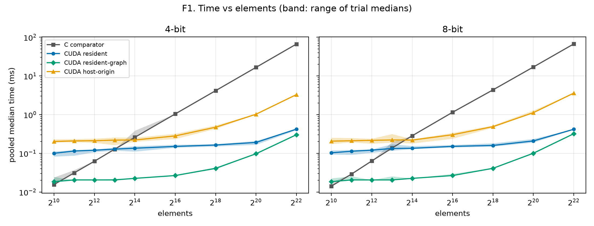
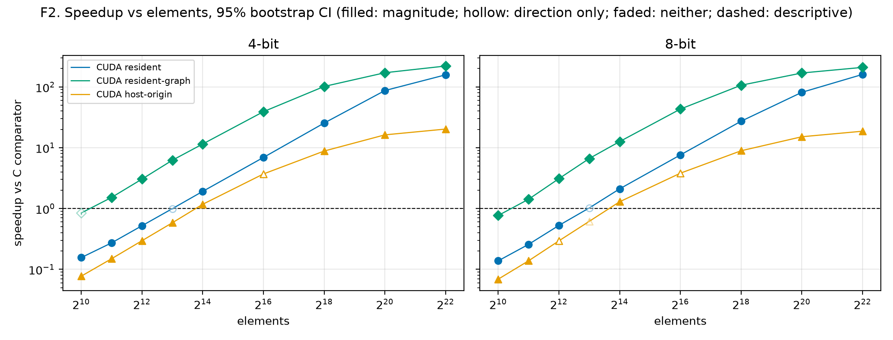
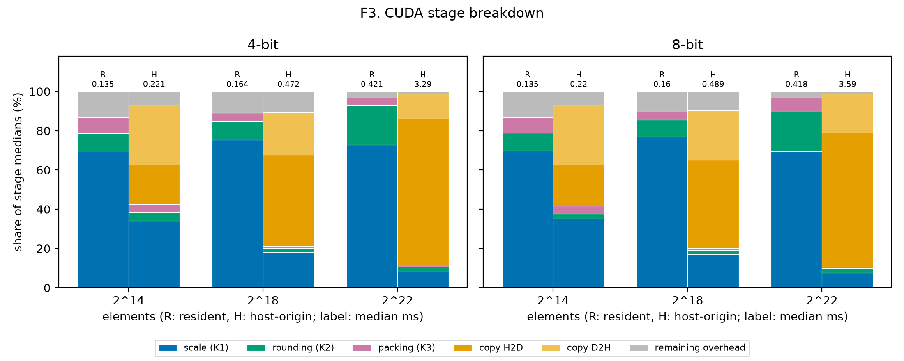
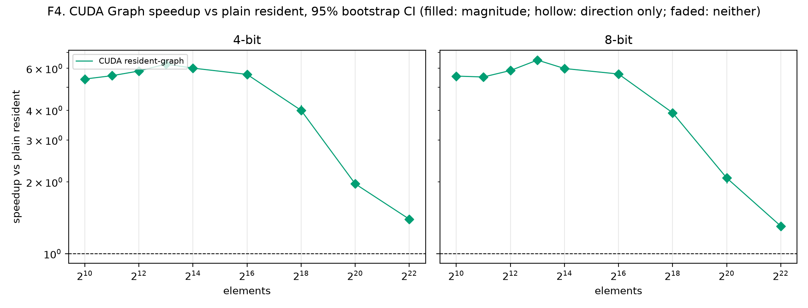
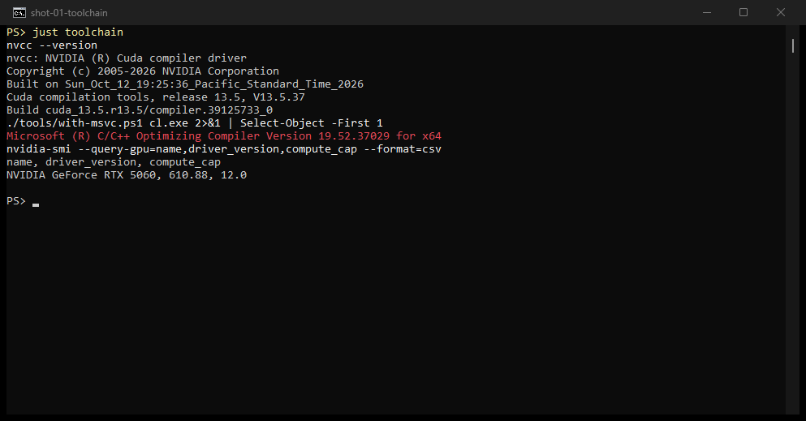
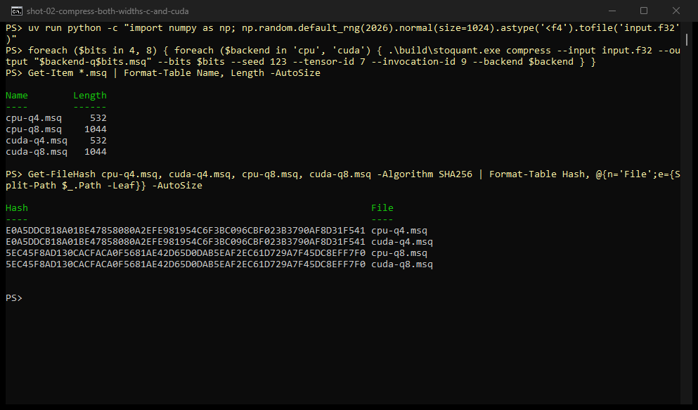
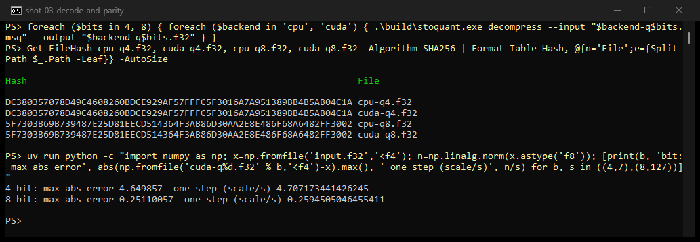
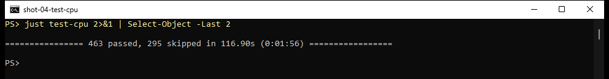
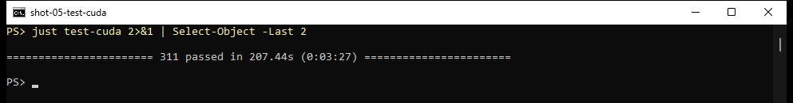
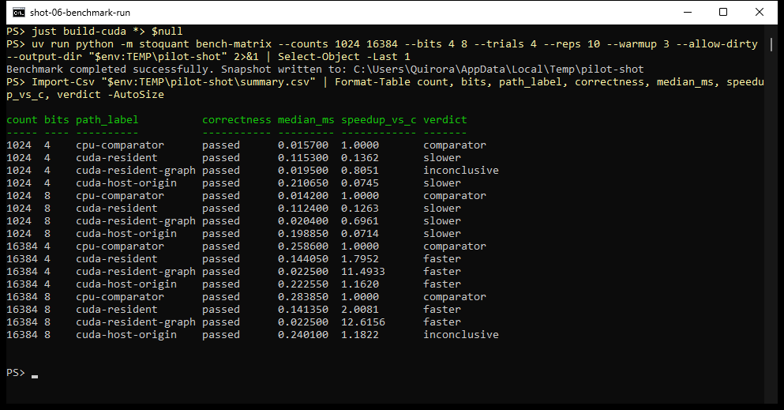

# CSC612M-MCO2-Code

## Final report

**Status: measurements are complete (two full nine-size sweeps) and the candidate verification receipt is written. Chan's rerun, the video, and the final report link are pending.**

### Purpose and scope

When does CUDA compression cost less time than sequential C compression? This project measures norm-scaled stochastic quantization: it replaces FP32 values with compact, randomly rounded codes and reconstructs approximations using a shared scale.

The required course comparison is **single-thread scalar C versus CUDA SIMT**, at **4 and 8 bits**, on dense synthetic vectors of **nine sizes from 1,024 to 4,194,304 elements** (2^10 to 2^14, then 2^16, 2^18, 2^20, 2^22).

This repository holds the course implementation, its tests, the benchmark tooling, and the earlier reports. The code comes from [stochastic-quantization-backends](https://github.com/qu1r0ra/stochastic-quantization-backends); the publication paper is a separate project. The table below links the source comparison and the verification receipt.

| Final provenance | Evidence |
| --- | --- |
| Course candidate and upstream correspondence | Compared at candidate `a2a746f` against upstream `9ccbe03`: native, vendored, and project-configuration sources match except one comment. Four course files changed afterward and were not compared again; course-specific omissions are listed in the [verification receipt](docs/verification-receipt.md#source-correspondence-with-the-upstream-repository). Shared Python differences not yet reviewed line by line. |
| Requirement coverage | [Requirement-to-evidence checklist](docs/course-requirements.md) |
| Candidate verification | [Verification receipt](docs/verification-receipt.md): ten commands, all exit 0, with environment, skipped checks, and source correspondence |
| Independent rerun (repeatability) | **TODO:** Chan's filled [receipt](docs/independent-rerun-receipt.md) from another machine, with revision, differences, failures, and scope exercised |

### Input, process, output

**Input:** raw little-endian FP32 values, a bit width of 4 or 8, a 64-bit seed, and 32-bit tensor and invocation identifiers. Empty and all-zero vectors use scale zero. Nonfinite values and norms unrepresentable as finite FP32 are rejected. Arbitrary lengths include odd lengths and partial CUDA blocks.

1. **K1, scale:** compute the L2 norm with max-rescaling and a fixed pairwise reduction order. CUDA distributes the reduction while preserving its logical order.
2. **K2, stochastic rounding:** normalize magnitudes and randomly choose adjacent integer codes. Philox4x32-10 maps the seed and identifiers to groups of four elements; launch geometry does not select random words.
3. **K3, packing:** CUDA packs on the GPU, with one thread writing each output byte. At 4 bits two codes share a byte; an odd final element leaves a zero high nibble. The host writes the header and decodes the returned record.

**Output:** a version-1 `MSQ1` record with a 20-byte header and `ceil(N*bits/8)` payload bytes. Decoding produces FP32 approximations. For nonempty input the byte compression ratio is `4*N / (20 + ceil(N*bits/8))`; tiny records can exceed input size. The [technical contract](docs/technical-contract.md) defines arithmetic, layout, and rejection rules.

### Design choices

- **Fixed reduction order.** Floating-point addition is not associative, so K1 uses one pairwise tree over 256-element blocks on both backends. The scale is then identical on CPU and CUDA, and the records can be compared byte for byte.
- **Counter-based random numbers.** Philox gives each group of four elements its random words from the seed and identifiers alone, so the rounding choices do not depend on thread scheduling or launch geometry.
- **Packing on the GPU.** K3 packs the codes before they leave the device. Copying unpacked codes back would lengthen the transfer that the host-origin path counts.
- **Scalar baseline.** The course asks for a sequential comparison, so the baseline is single-threaded, unvectorized C.

### Build, verify, and run

Use PowerShell from the repository root. Install Python 3.11 or newer, `uv`, `just`, Git, and Visual Studio's x64 C++ tools. CUDA execution needs a compatible NVIDIA GPU, driver, and toolkit. The build wrapper locates MSVC without a developer prompt. Record actual versions; the [reproduction guide](docs/reproduction.md) describes the historical environment.

```powershell
uv sync --group dev
just test-cpu
just verify

# CUDA machine only
$env:CUDA_ARCH = 'native'
just toolchain
just test-rng
just test-cuda
```

`test-cpu` builds the CPU CLI and the native tests, then runs the Python oracle and CLI suite. `test-cuda` builds a CUDA-enabled CLI and runs the CUDA acceptance tests. Both write the same `build\stoquant.exe`, so after a CPU build, rebuild CUDA before using `--backend cuda`.

Generate input, compress at both widths with both required backends, and decode:

```powershell
uv run python -c "import numpy as np; np.random.default_rng(2026).normal(size=1024).astype('<f4').tofile('input.f32')"
just build-cuda
foreach ($bits in 4, 8) {
    foreach ($backend in 'cpu', 'cuda') {
        .\build\stoquant.exe compress --input input.f32 --output "$backend-q$bits.msq" --bits $bits --seed 123 --tensor-id 7 --invocation-id 9 --backend $backend
        .\build\stoquant.exe decompress --input "$backend-q$bits.msq" --output "$backend-q$bits.f32"
    }
    Get-FileHash "cpu-q$bits.msq", "cuda-q$bits.msq" -Algorithm SHA256
}
```

Matching hashes show that C and CUDA produced the same record for this input. The decoded values are approximations of the input, so check them numerically. On a CPU-only machine, use `just build-cpu` and only `'cpu'` in the inner loop.

### Evaluation methodology

The four course benchmark paths are scalar C (`cpu-comparator`), CUDA resident, CUDA resident-graph, and CUDA host-origin. Resident paths start and finish in device memory. Host-origin includes pageable input upload and packed payload/scale download. Graph replay excludes capture/instantiation and repeats the captured invocation's random stream. Allocation, input generation, file I/O, correctness checks, and host decoding are outside compression timing.

The [benchmark protocol](docs/benchmark-protocol.md) defines synchronized elapsed timing, balanced path orders over repeated processes, warm-ups, raw samples, medians, IQR, trial ranges, and evidence eligibility. Stage events diagnose costs; summing stage medians does not produce measured end-to-end time. Report absolute scalar time beside speedups, preserve losing/inconclusive cases, and distinguish supported direction from supported magnitude.

These commands call the driver directly and skip the notification setup that the `just bench-matrix` wrapper needs. Run them from a clean, committed tree. The pilot is not evidence; review it and the readiness checks before starting the course sweep.

```powershell
just build-cuda
just build-stream-probe
uv run python -m stoquant bench-matrix --pilot
# After reviewing the pilot and satisfying readiness:
uv run python -m stoquant bench-matrix --course
```

`--course` runs the nine-size grid at 4 and 8 bits on the four paths (72 cases) and cannot be combined with `--counts` or `--bits`. Keep dense inputs and default paths. Readiness checks cover memory, competing processes, clean Git state, and GPU clock-event reasons. Pilots and readiness overrides are non-evidence. Preserve manifests, build/source provenance, input hashes, correctness results, raw samples, and `summary.csv` unchanged.

Verification covers prescribed-scale/random-word cases, CPU/CUDA bytes and scales, FP64 reconstruction bounds, empirical means across seeds, Philox known-answer/mapping checks, malformed records, nonfinite/overflow rejection, saturation, zero, and tail/odd lengths at both widths. Source correspondence requires matching-input/seed comparison against the pinned upstream revision. Historical test counts do not verify a final candidate. The final candidate's results (463 CPU tests passed with 295 skipped by design, 311 CUDA tests passed, 6 of 6 record-identity cases, 8 of 8 unbiasedness cases at 4,096 seeds) are in the [verification receipt](docs/verification-receipt.md).

### Final measured outcomes

Two complete sweeps used the same command on the same machine, with nothing else running. Both are kept, and neither replaces the other. The tables below use the headline sweep; the second sweep is summarized after them.

| Snapshot | Revision | Role |
| --- | --- | --- |
| [`2026-11-17-3feab89`](results/2026-11-17-3feab89/) | `3feab89` | Headline sweep |
| [`2026-11-17-fbeede0`](results/2026-11-17-fbeede0/) | `fbeede0` | Second sweep (code identical to `3feab89` except three `.gitattributes` lines) |

An earlier pair of four-size sweeps (`2026-11-16-b3b3e8a`, `2026-11-16-4f1ae10`) placed the crossover somewhere between 1,024 and 16,384 elements. They are superseded history and supply no number here.

Setup, the same for both sweeps: NVIDIA GeForce RTX 5060 (`sm_120`), driver 610.88, Windows 11 Pro 10.0.26300, CUDA 13.5 (V13.5.37), MSVC 19.52.37029 x64. Command: `just bench-matrix --course`. That is 72 cases (4 paths, 9 sizes, 2 widths), each 24 trials of 30 measured repetitions after 10 warm-ups, on dense FP32 normal input. A sweep takes about 36 minutes. The Git tree was clean, and readiness passed without override. All 72 correctness checks passed in each sweep.

Pooled median times, headline sweep (ms):

| Elements | Bits | C comparator | CUDA resident | CUDA resident-graph | CUDA host-origin |
| --- | ---: | ---: | ---: | ---: | ---: |
| 2^10 | 4 | 0.0156 | 0.1001 | 0.0185 | 0.2023 |
| 2^10 | 8 | 0.0142 | 0.103 | 0.0185 | 0.2062 |
| 2^11 | 4 | 0.0312 | 0.1145 | 0.0205 | 0.2089 |
| 2^11 | 8 | 0.0291 | 0.1132 | 0.0205 | 0.2108 |
| 2^12 | 4 | 0.0624 | 0.1199 | 0.0205 | 0.2113 |
| 2^12 | 8 | 0.0635 | 0.1205 | 0.0205 | 0.216 |
| 2^13 | 4 | 0.1275 | 0.1283 | 0.0205 | 0.2188 |
| 2^13 | 8 | 0.1362 | 0.1332 | 0.0205 | 0.2212 |
| 2^14 | 4 | 0.2586 | 0.1353 | 0.0225 | 0.2205 |
| 2^14 | 8 | 0.2837 | 0.1348 | 0.0225 | 0.2196 |
| 2^16 | 4 | 1.04 | 0.1506 | 0.0266 | 0.2812 |
| 2^16 | 8 | 1.148 | 0.1511 | 0.0266 | 0.3015 |
| 2^18 | 4 | 4.155 | 0.1635 | 0.0409 | 0.4716 |
| 2^18 | 8 | 4.354 | 0.1597 | 0.0409 | 0.4889 |
| 2^20 | 4 | 16.62 | 0.191 | 0.0973 | 1.022 |
| 2^20 | 8 | 16.97 | 0.2086 | 0.1003 | 1.122 |
| 2^22 | 4 | 66.5 | 0.4215 | 0.302 | 3.285 |
| 2^22 | 8 | 67.05 | 0.4183 | 0.3205 | 3.593 |



*Median time against input size, headline sweep. C time rises faster than any CUDA time and passes host-origin between 2^13 and 2^14 elements. Bands show the range of trial medians; lines join measured sizes only.*

Speedup over the comparator, with its verdict and trial range, headline sweep. A dagger marks a supported direction whose spread exceeds 1.25, so only the direction is claimed.

| Elements | Bits | CUDA resident | CUDA resident-graph | CUDA host-origin |
| --- | ---: | --- | --- | --- |
| 2^10 | 4 | slower, 0.156× [0.138, 0.288] | inconclusive, 0.843× [0.633, 1.29] | slower, 0.0771× [0.0673, 0.126] |
| 2^10 | 8 | slower, 0.138× [0.119, 0.191] | slower, 0.768× [0.631, 0.967] | slower, 0.0689× [0.056, 0.103] |
| 2^11 | 4 | slower, 0.272× [0.255, 0.425] | faster, 1.52× [1.52, 1.82] | slower, 0.149× [0.133, 0.191] |
| 2^11 | 8 | slower, 0.257× [0.237, 0.318] | faster, 1.42× [1.14, 1.43] | slower, 0.138× [0.116, 0.15] |
| 2^12 | 4 | slower, 0.521× [0.491, 0.59] | faster, 3.04× [3.04, 3.1] | slower, 0.295× [0.26, 0.337] |
| 2^12 | 8 | slower, 0.527× [0.5, 0.616] | faster, 3.1× [3.09, 3.12] | slower†, 0.294× [0.266, 0.361] |
| 2^13 | 4 | inconclusive, 0.994× [0.905, 1.08] | faster, 6.22× [5.79, 6.22] | slower, 0.583× [0.495, 0.784] |
| 2^13 | 8 | inconclusive, 1.02× [0.791, 1.67] | faster, 6.64× [5.33, 9.57] | inconclusive, 0.616× [0.43, 1.03] |
| 2^14 | 4 | faster, 1.91× [1.69, 3.47] | faster, 11.5× [11.5, 17.2] | faster, 1.17× [1.01, 1.93] |
| 2^14 | 8 | faster, 2.1× [1.84, 2.2] | faster, 12.6× [12.6, 12.6] | faster, 1.29× [1.22, 1.58] |
| 2^16 | 4 | faster, 6.91× [6.22, 7.42] | faster, 39.1× [38.4, 39.1] | faster†, 3.7× [3.24, 4.42] |
| 2^16 | 8 | faster, 7.6× [6.96, 8.13] | faster, 43.2× [38.7, 43.3] | faster†, 3.81× [3.39, 4.82] |
| 2^18 | 4 | faster, 25.4× [23.9, 27.7] | faster, 102× [96.6, 107] | faster, 8.81× [7.9, 9.67] |
| 2^18 | 8 | faster, 27.3× [23.9, 29.2] | faster, 106× [104, 107] | faster, 8.91× [8.28, 9.44] |
| 2^20 | 4 | faster, 87× [79.3, 101] | faster, 171× [171, 175] | faster, 16.3× [15.9, 16.8] |
| 2^20 | 8 | faster, 81.4× [72.2, 89.7] | faster, 169× [167, 173] | faster, 15.1× [13.2, 15.4] |
| 2^22 | 4 | faster, 158× [154, 168] | faster, 220× [220, 223] | faster, 20.2× [19.3, 20.5] |
| 2^22 | 8 | faster, 160× [159, 165] | faster, 209× [208, 210] | faster, 18.7× [18.4, 18.7] |



*Speedup over scalar C, headline sweep, with 95% bootstrap intervals over trial medians. Filled markers have a supported direction and magnitude, hollow markers a supported direction only, and faded markers an inconclusive verdict.*

- **Small inputs favor the scalar comparator.** At 2^10 elements the comparator is faster than resident and host-origin at both widths. Graph replay is slower at 8 bits and inconclusive at 4 bits. Fixed launch and transfer overhead is a likely explanation; these runs do not measure it.
- **Host-origin crossover.** Host-origin, the path that counts copies, is slower through 2^12 elements and faster from 2^14 at both widths. At 4 bits the crossover lies between 2^13 and 2^14 (8,192 and 16,384 elements) in both sweeps. At 8 bits the second sweep gives the same interval; in the headline sweep the 2^13 case is inconclusive (0.616×, trial range 0.43 to 1.03), so that sweep brackets it only between 2^12 and 2^14. The 4-bit 2^14 margin is the thinnest in the table (1.17×, trial range 1.01 to 1.93). Nothing was measured between 2^13 and 2^14.
- **Resident paths.** Resident is slower through 2^12, inconclusive at 2^13 at both widths, and faster from 2^14. Resident-graph at 8 bits crosses between 2^10 and 2^11. At 4 bits it has no size with a supported slower verdict, because its 2^10 case is inconclusive; it is faster from 2^11.
- **The gap widens with size.** In the headline sweep the speedup grows with every step in size for every path and width. At 2^22, resident reaches 158–160×, resident-graph 209–220×, and host-origin 18.7–20.2× (the comparator takes 66.5 and 67.1 ms). Host-origin includes host–device copies that the resident paths exclude. At 2^22 and 4 bits that is 3.29 ms against 0.42 ms.
- **Repeatability.** The two sweeps ran on one machine by one operator and give the same verdict in 53 of 54 CUDA cases. The one difference is host-origin at 2^13 and 8 bits: inconclusive in the headline sweep and slower in the second (0.616× and 0.627×). The largest change in any median between sweeps is 7.6%, and the largest change in any speedup is 7.1%, both at 2^10, 4-bit, resident.
- **Spread check.** Three headline cells keep their direction but exceed the 1.25 spread limit (host-origin at 2^12 and 8 bits, and at 2^16 at both widths); the second sweep has two, both at 2^16. They carry a direction claim only and are marked † above.
- **Record sizes.** Each record has a 20-byte header and a payload of n/2 bytes at 4 bits or n bytes at 8 bits. At 2^22 elements that is 2,097,152 and 4,194,304 payload bytes.



*Where host-origin time goes, headline sweep: CUDA stage medians for resident (R) and host-origin (H) at three sizes, with the path median above each bar. Copies are about half of host-origin time at 2^14 and most of it at 2^18 and 2^22. Stage times diagnose the split and are not added into path times.*



*Graph replay against plain resident launches, headline sweep. Replay is faster at every size and width, most at small sizes and least at 2^22. Neither path includes copies, and graph capture is excluded.*

Full per-case tables and crossover detail are in the [headline report](results/2026-11-17-3feab89/derived/report.md) and the [second-sweep report](results/2026-11-17-fbeede0/derived/report.md), which has its own copies of these figures.

### Limitations and lessons

This measures synthetic-vector compression and reconstruction, without training accuracy, convergence, network transmission, or federated-learning benefit. Ideal-arithmetic unbiasedness differs from finite-precision and empirical checks. Scalar C speedups do not establish an advantage over every optimized CPU implementation. Resident timings exclude transfers; graph replay uses a different launch boundary. A rerun on another machine establishes only the behavior it exercised. A100 and publication experiments are separate work.

**TODO (AHA moments):** record observed surprises, the execution or debugging evidence behind each, and what changed in the team's understanding. Keep measured explanations apart from hypotheses.

### Execution screenshots

All six captures come from the RTX 5060 machine at revision `9f6a687`. Its source matches the measured revision `3feab89` apart from `.gitattributes`; the other changes since then are documentation and result snapshots. The input is a 1,024-element float32 vector (numpy seed 2026) with `--seed 123 --tensor-id 7 --invocation-id 9`.



*`just toolchain`: CUDA 13.5 compiler, MSVC 19.52, and the RTX 5060 (compute capability 12.0, driver 610.88).*



*`stoquant compress --bits {4,8} --backend {cpu,cuda}`: the records are 532 bytes at 4 bits and 1,044 bytes at 8 bits. Each width has the same SHA-256 hash from both backends.*



*`stoquant decompress` on the four records: the decoded files are identical across backends. The maximum absolute error is 4.649857 at 4 bits (one quantization step is 4.7071) and 0.25110057 at 8 bits (one step is 0.2594).*



*`just test-cpu`: 463 passed and 295 skipped (the skipped cases need CUDA).*



*`just test-cuda`: 311 passed.*



*`stoquant bench-matrix` with `--counts 1024 16384 --bits 4 8 --trials 4 --reps 10 --warmup 3`: all 16 cases pass the correctness gate. This reduced run shows the harness and the summary table only. The reported results come from the two full sweeps above.*

### Final artifacts (pending)

- **TODO (final video):** add the recording link after checking playback, audio, the execution segments, and length. The plan is at most 20 minutes, pending the instructor's confirmation.
- **TODO (final course report):** link the built PDF of the course report (drafted in the paper repository, `course/final/report/`) and verify access. Keep the separate publication paper outside the package.

---

## Checkpoint 2

- [Milestone report](checkpoint2-milestone-report.pdf): the Week 10 progress report against the proposal, with the remaining work.
- [Update video](https://drive.google.com/file/d/1zJISAswdwxyUksUcP5S6J4XF97GNEwYM/view?usp=sharing) (Google Drive): the Week 10 mid-project update.
- [Checkpoint verification and benchmark summary](CHECKPOINT-WORKING-EVIDENCE.md): test results, the correctness gate, and the timing table.
- [Benchmark snapshot](results/2026-10-29-b2f6b09/): raw records and `summary.csv` for revision `b2f6b09`, produced by `uv run python -m stoquant bench-matrix --counts 1024 262144 4194304 --bits 4 8`.

This snapshot covers three sizes at an older revision and supplies no final results. Its report lists the work left for the final: the fourth size, more decoder and edge-case checks, instructions, a demonstration, and a teammate's independent rerun.

---

## Proposal

- [Proposal paper](proposal-paper.pdf): "When Does the GPU Pay Off? Stage-Level Costs of Stochastic Quantization in CUDA".
- [Proposal video](https://drive.google.com/drive/folders/1xVHdF_vXFP3a5Te5dYMXvwBCPO8gHVm5?usp=sharing) (Google Drive).
