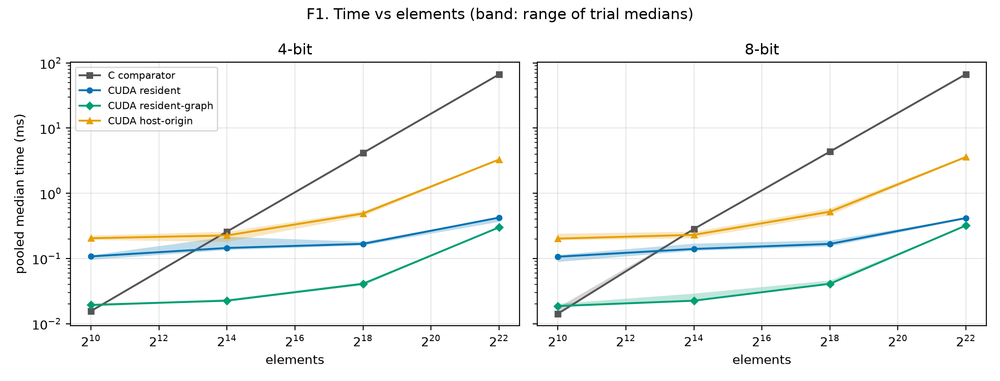
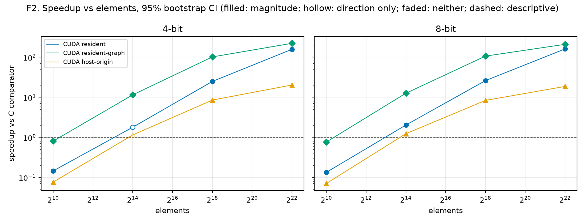
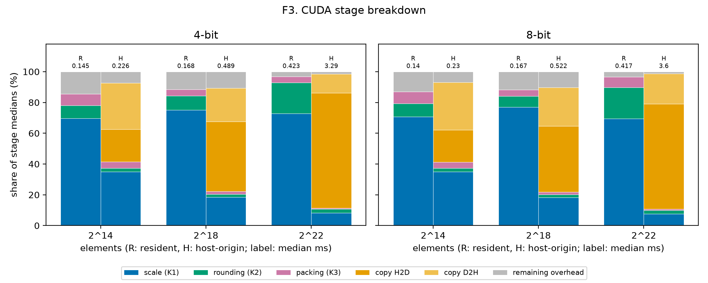
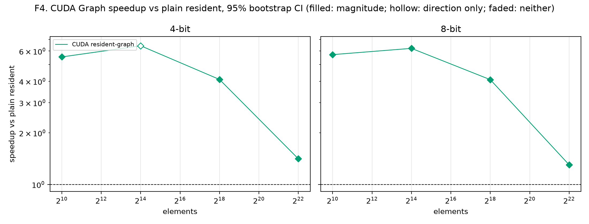

# Size sweep report (2026-11-15-c38c099)

Generated by `bench_report.py` from snapshot revision `c38c099`, 32 cases, all passed: True.

## Crossover

Located from the direction claim on both sides of the flip.

- CUDA resident, 4-bit: resolved between 2^10 and 2^14 elements (slower to faster).
- CUDA resident-graph, 4-bit: resolved between 2^10 and 2^14 elements (slower to faster).
- CUDA host-origin, 4-bit: not resolved (largest supported slower size: 2^10; smallest supported faster size: 2^18).
- CUDA resident, 8-bit: resolved between 2^10 and 2^14 elements (slower to faster).
- CUDA resident-graph, 8-bit: resolved between 2^10 and 2^14 elements (slower to faster).
- CUDA host-origin, 8-bit: resolved between 2^10 and 2^14 elements (slower to faster).

### Revision 2 crossover

Located from the unchanged revision 2 claim, for comparison.

- CUDA resident, 4-bit: not resolved (largest supported slower size: 2^10; smallest supported faster size: 2^18).
- CUDA resident-graph, 4-bit: resolved between 2^10 and 2^14 elements (slower to faster).
- CUDA host-origin, 4-bit: not resolved (largest supported slower size: 2^10; smallest supported faster size: 2^18).
- CUDA resident, 8-bit: not resolved (largest supported slower size: none; smallest supported faster size: 2^18).
- CUDA resident-graph, 8-bit: not resolved (largest supported slower size: none; smallest supported faster size: 2^18).
- CUDA host-origin, 8-bit: not resolved (largest supported slower size: none; smallest supported faster size: 2^22).

## T1. Summary

Times are pooled medians. Speedup is C median over CUDA median. The trial range decides the verdict; the 95% CI is the bootstrap interval over trial medians, so a speedup can lie outside its CI. Direction, magnitude and revision 2 are the claim rules recorded in the manifest; — marks a field the snapshot predates.

| Elements | Bits | Path | C (ms) | CUDA (ms) | Speedup | Trial range | 95% CI | Verdict | Direction | Magnitude | Rev 2 |
|---|---|---|---|---|---|---|---|---|---|---|---|
| 2^10 | 4 | CUDA resident | 0.0156 | 0.1076 | 0.145× | [0.138, 0.162] | [0.142, 0.148] | slower | yes | yes | yes |
| 2^10 | 4 | CUDA resident-graph | 0.0156 | 0.0194 | 0.804× | [0.787, 0.848] | [0.802, 0.828] | slower | yes | yes | yes |
| 2^10 | 4 | CUDA host-origin | 0.0156 | 0.2044 | 0.0763× | [0.0686, 0.0803] | [0.075, 0.0781] | slower | yes | yes | yes |
| 2^10 | 8 | CUDA resident | 0.0142 | 0.1064 | 0.133× | [0.124, 0.201] | [0.13, 0.136] | slower | yes | yes | no |
| 2^10 | 8 | CUDA resident-graph | 0.0142 | 0.0186 | 0.763× | [0.698, 0.973] | [0.732, 0.77] | slower | yes | yes | no |
| 2^10 | 8 | CUDA host-origin | 0.0142 | 0.2016 | 0.0704× | [0.0588, 0.0934] | [0.0697, 0.072] | slower | yes | yes | no |
| 2^14 | 4 | CUDA resident | 0.2586 | 0.1449 | 1.78× | [1.19, 1.92] | [1.73, 1.87] | faster | yes | no | no |
| 2^14 | 4 | CUDA resident-graph | 0.2586 | 0.0225 | 11.5× | [10.8, 11.6] | [11.5, 11.5] | faster | yes | yes | yes |
| 2^14 | 4 | CUDA host-origin | 0.2586 | 0.2257 | 1.15× | [0.996, 1.44] | [1.11, 1.2] | inconclusive | no | no | no |
| 2^14 | 8 | CUDA resident | 0.2838 | 0.14 | 2.03× | [1.67, 2.17] | [2.01, 2.05] | faster | yes | yes | no |
| 2^14 | 8 | CUDA resident-graph | 0.2838 | 0.0225 | 12.6× | [9.73, 12.7] | [12.6, 12.6] | faster | yes | yes | no |
| 2^14 | 8 | CUDA host-origin | 0.2838 | 0.2304 | 1.23× | [1.09, 1.39] | [1.2, 1.27] | faster | yes | yes | no |
| 2^18 | 4 | CUDA resident | 4.159 | 0.1676 | 24.8× | [22.8, 26.7] | [24.3, 25.2] | faster | yes | yes | yes |
| 2^18 | 4 | CUDA resident-graph | 4.159 | 0.0409 | 102× | [96.6, 109] | [102, 104] | faster | yes | yes | yes |
| 2^18 | 4 | CUDA host-origin | 4.159 | 0.4893 | 8.5× | [7.8, 9.47] | [8.36, 8.81] | faster | yes | yes | yes |
| 2^18 | 8 | CUDA resident | 4.357 | 0.1672 | 26.1× | [22.8, 28.7] | [25.3, 26.6] | faster | yes | yes | yes |
| 2^18 | 8 | CUDA resident-graph | 4.357 | 0.0409 | 107× | [94.2, 108] | [106, 107] | faster | yes | yes | yes |
| 2^18 | 8 | CUDA host-origin | 4.357 | 0.5218 | 8.35× | [7.37, 9.5] | [8.24, 8.6] | faster | yes | yes | no |
| 2^22 | 4 | CUDA resident | 66.63 | 0.4234 | 157× | [155, 183] | [157, 159] | faster | yes | yes | yes |
| 2^22 | 4 | CUDA resident-graph | 66.63 | 0.3 | 222× | [215, 224] | [222, 222] | faster | yes | yes | yes |
| 2^22 | 4 | CUDA host-origin | 66.63 | 3.293 | 20.2× | [19.6, 20.5] | [20.2, 20.3] | faster | yes | yes | yes |
| 2^22 | 8 | CUDA resident | 67.21 | 0.4173 | 161× | [159, 167] | [161, 161] | faster | yes | yes | yes |
| 2^22 | 8 | CUDA resident-graph | 67.21 | 0.3205 | 210× | [209, 212] | [210, 211] | faster | yes | yes | yes |
| 2^22 | 8 | CUDA host-origin | 67.21 | 3.605 | 18.6× | [17.8, 18.8] | [18.6, 18.7] | faster | yes | yes | yes |

## Figures

- 
- 
- 
- 
