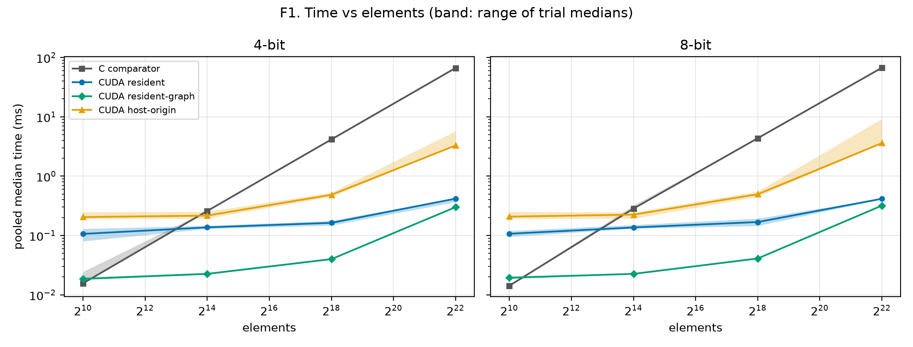
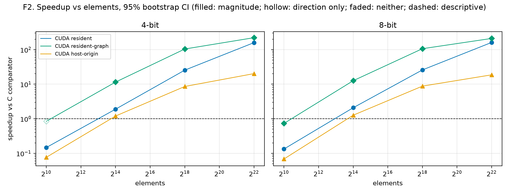
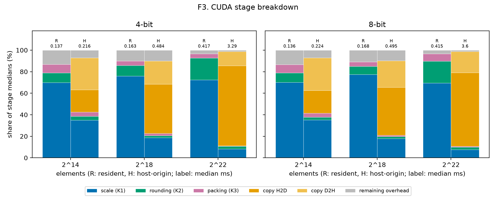
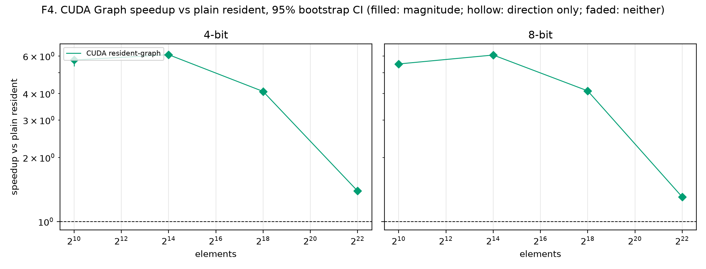

# Size sweep report (2026-11-16-4f1ae10)

Generated by `bench_report.py` from snapshot revision `4f1ae10`, 32 cases, all passed: True.

## Crossover

Located from the direction claim on both sides of the flip.

- CUDA resident, 4-bit: resolved between 2^10 and 2^14 elements (slower to faster).
- CUDA resident-graph, 4-bit: not resolved (largest supported slower size: none; smallest supported faster size: 2^14).
- CUDA host-origin, 4-bit: resolved between 2^10 and 2^14 elements (slower to faster).
- CUDA resident, 8-bit: resolved between 2^10 and 2^14 elements (slower to faster).
- CUDA resident-graph, 8-bit: resolved between 2^10 and 2^14 elements (slower to faster).
- CUDA host-origin, 8-bit: resolved between 2^10 and 2^14 elements (slower to faster).

### Revision 2 crossover

Located from the unchanged revision 2 claim, for comparison.

- CUDA resident, 4-bit: not resolved (largest supported slower size: none; smallest supported faster size: 2^14).
- CUDA resident-graph, 4-bit: not resolved (largest supported slower size: none; smallest supported faster size: 2^14).
- CUDA host-origin, 4-bit: not resolved (largest supported slower size: none; smallest supported faster size: 2^18).
- CUDA resident, 8-bit: not resolved (largest supported slower size: none; smallest supported faster size: 2^14).
- CUDA resident-graph, 8-bit: resolved between 2^10 and 2^14 elements (slower to faster).
- CUDA host-origin, 8-bit: not resolved (largest supported slower size: none; smallest supported faster size: 2^18).

## T1. Summary

Times are pooled medians. Speedup is C median over CUDA median. The trial range decides the verdict; the 95% CI is the bootstrap interval over trial medians, so a speedup can lie outside its CI. Direction, magnitude and revision 2 are the claim rules recorded in the manifest; — marks a field the snapshot predates.

| Elements | Bits | Path | C (ms) | CUDA (ms) | Speedup | Trial range | 95% CI | Verdict | Direction | Magnitude | Rev 2 |
|---|---|---|---|---|---|---|---|---|---|---|---|
| 2^10 | 4 | CUDA resident | 0.0156 | 0.1062 | 0.147× | [0.12, 0.305] | [0.139, 0.154] | slower | yes | yes | no |
| 2^10 | 4 | CUDA resident-graph | 0.0156 | 0.0185 | 0.843× | [0.783, 1.33] | [0.804, 0.843] | inconclusive | no | no | no |
| 2^10 | 4 | CUDA host-origin | 0.0156 | 0.2039 | 0.0765× | [0.0626, 0.129] | [0.0737, 0.0786] | slower | yes | yes | no |
| 2^10 | 8 | CUDA resident | 0.0142 | 0.1068 | 0.133× | [0.119, 0.152] | [0.129, 0.138] | slower | yes | yes | no |
| 2^10 | 8 | CUDA resident-graph | 0.0142 | 0.0194 | 0.732× | [0.696, 0.783] | [0.73, 0.75] | slower | yes | yes | yes |
| 2^10 | 8 | CUDA host-origin | 0.0142 | 0.2075 | 0.0684× | [0.0566, 0.0752] | [0.0651, 0.069] | slower | yes | yes | no |
| 2^14 | 4 | CUDA resident | 0.2586 | 0.1368 | 1.89× | [1.77, 2.02] | [1.86, 1.92] | faster | yes | yes | yes |
| 2^14 | 4 | CUDA resident-graph | 0.2586 | 0.0225 | 11.5× | [11, 11.9] | [11.5, 11.5] | faster | yes | yes | yes |
| 2^14 | 4 | CUDA host-origin | 0.2586 | 0.2161 | 1.2× | [1.03, 1.35] | [1.16, 1.25] | faster | yes | yes | no |
| 2^14 | 8 | CUDA resident | 0.2838 | 0.1363 | 2.08× | [1.88, 2.46] | [2.02, 2.13] | faster | yes | yes | yes |
| 2^14 | 8 | CUDA resident-graph | 0.2838 | 0.0225 | 12.6× | [12.6, 14.3] | [12.6, 12.6] | faster | yes | yes | yes |
| 2^14 | 8 | CUDA host-origin | 0.2838 | 0.2243 | 1.27× | [1.16, 1.67] | [1.25, 1.31] | faster | yes | yes | no |
| 2^18 | 4 | CUDA resident | 4.156 | 0.1631 | 25.5× | [23.5, 28.2] | [24.7, 26.4] | faster | yes | yes | yes |
| 2^18 | 4 | CUDA resident-graph | 4.156 | 0.0399 | 104× | [101, 107] | [102, 107] | faster | yes | yes | yes |
| 2^18 | 4 | CUDA host-origin | 4.156 | 0.4844 | 8.58× | [7.85, 9.27] | [8.46, 8.79] | faster | yes | yes | yes |
| 2^18 | 8 | CUDA resident | 4.353 | 0.1682 | 25.9× | [22.5, 30] | [25.2, 26.8] | faster | yes | yes | no |
| 2^18 | 8 | CUDA resident-graph | 4.353 | 0.0409 | 106× | [104, 107] | [106, 106] | faster | yes | yes | yes |
| 2^18 | 8 | CUDA host-origin | 4.353 | 0.4952 | 8.79× | [7.87, 9.68] | [8.65, 8.92] | faster | yes | yes | yes |
| 2^22 | 4 | CUDA resident | 66.51 | 0.4174 | 159× | [155, 185] | [158, 162] | faster | yes | yes | yes |
| 2^22 | 4 | CUDA resident-graph | 66.51 | 0.3001 | 222× | [217, 225] | [221, 222] | faster | yes | yes | yes |
| 2^22 | 4 | CUDA host-origin | 66.51 | 3.289 | 20.2× | [11.6, 20.6] | [20.2, 20.3] | faster | yes | yes | no |
| 2^22 | 8 | CUDA resident | 67.17 | 0.4154 | 162× | [160, 166] | [161, 162] | faster | yes | yes | yes |
| 2^22 | 8 | CUDA resident-graph | 67.17 | 0.3185 | 211× | [209, 214] | [211, 211] | faster | yes | yes | yes |
| 2^22 | 8 | CUDA host-origin | 67.17 | 3.602 | 18.7× | [7.26, 19] | [18.6, 18.7] | faster | yes | yes | no |

## Figures

- 
- 
- 
- 
