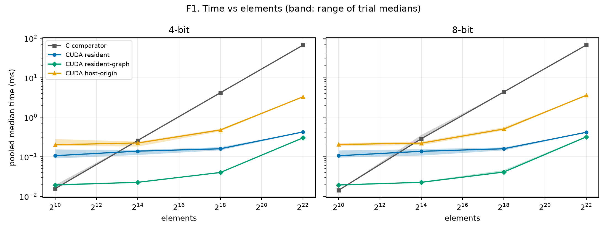
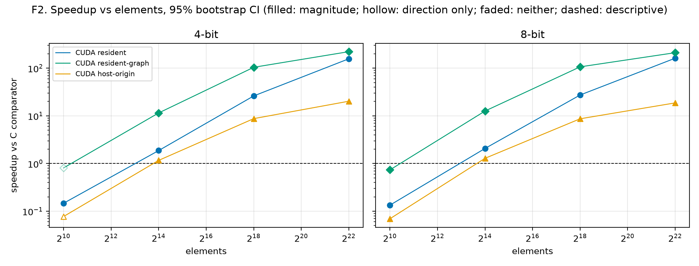
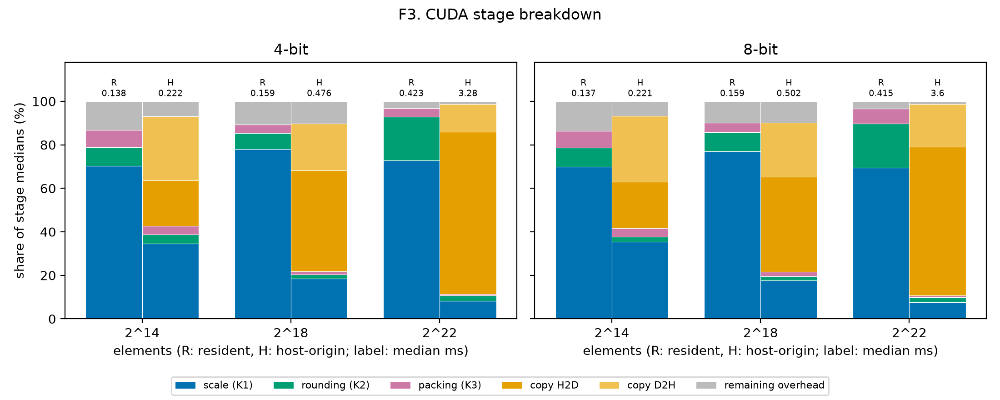
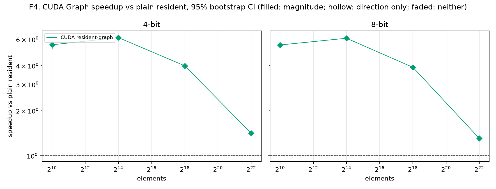

# Size sweep report (2026-11-16-b3b3e8a)

Generated by `bench_report.py` from snapshot revision `b3b3e8a`, 32 cases, all passed: True.

## Crossover

Located from the direction claim on both sides of the flip.

- CUDA resident, 4-bit: resolved between 2^10 and 2^14 elements (slower to faster).
- CUDA resident-graph, 4-bit: not resolved (largest supported slower size: none; smallest supported faster size: 2^14).
- CUDA host-origin, 4-bit: resolved between 2^10 and 2^14 elements (slower to faster).
- CUDA resident, 8-bit: resolved between 2^10 and 2^14 elements (slower to faster).
- CUDA resident-graph, 8-bit: resolved between 2^10 and 2^14 elements (slower to faster).
- CUDA host-origin, 8-bit: resolved between 2^10 and 2^14 elements (slower to faster).

### Revision 2 crossover

Located from the unchanged revision 2 claim, for comparison.

- CUDA resident, 4-bit: not resolved (largest supported slower size: none; smallest supported faster size: 2^18).
- CUDA resident-graph, 4-bit: not resolved (largest supported slower size: none; smallest supported faster size: 2^14).
- CUDA host-origin, 4-bit: not resolved (largest supported slower size: none; smallest supported faster size: 2^18).
- CUDA resident, 8-bit: not resolved (largest supported slower size: none; smallest supported faster size: 2^18).
- CUDA resident-graph, 8-bit: not resolved (largest supported slower size: 2^10; smallest supported faster size: 2^18).
- CUDA host-origin, 8-bit: not resolved (largest supported slower size: 2^10; smallest supported faster size: 2^18).

## T1. Summary

Times are pooled medians. Speedup is C median over CUDA median. The trial range decides the verdict; the 95% CI is the bootstrap interval over trial medians, so a speedup can lie outside its CI. Direction, magnitude and revision 2 are the claim rules recorded in the manifest; — marks a field the snapshot predates.

| Elements | Bits | Path | C (ms) | CUDA (ms) | Speedup | Trial range | 95% CI | Verdict | Direction | Magnitude | Rev 2 |
|---|---|---|---|---|---|---|---|---|---|---|---|
| 2^10 | 4 | CUDA resident | 0.0156 | 0.1063 | 0.147× | [0.101, 0.215] | [0.143, 0.157] | slower | yes | yes | no |
| 2^10 | 4 | CUDA resident-graph | 0.0156 | 0.0193 | 0.808× | [0.76, 1.07] | [0.804, 0.839] | inconclusive | no | no | no |
| 2^10 | 4 | CUDA host-origin | 0.0156 | 0.2016 | 0.0774× | [0.0549, 0.104] | [0.0755, 0.0812] | slower | yes | no | no |
| 2^10 | 8 | CUDA resident | 0.0142 | 0.106 | 0.134× | [0.0979, 0.149] | [0.132, 0.14] | slower | yes | yes | no |
| 2^10 | 8 | CUDA resident-graph | 0.0142 | 0.0193 | 0.736× | [0.717, 0.777] | [0.732, 0.768] | slower | yes | yes | yes |
| 2^10 | 8 | CUDA host-origin | 0.0142 | 0.2044 | 0.0695× | [0.0638, 0.0755] | [0.0685, 0.0718] | slower | yes | yes | yes |
| 2^14 | 4 | CUDA resident | 0.2586 | 0.1384 | 1.87× | [1.72, 2.32] | [1.85, 1.89] | faster | yes | yes | no |
| 2^14 | 4 | CUDA resident-graph | 0.2586 | 0.0225 | 11.5× | [11, 11.5] | [11.5, 11.5] | faster | yes | yes | yes |
| 2^14 | 4 | CUDA host-origin | 0.2586 | 0.2223 | 1.16× | [1.07, 1.42] | [1.14, 1.2] | faster | yes | yes | no |
| 2^14 | 8 | CUDA resident | 0.2838 | 0.1371 | 2.07× | [1.81, 3.33] | [2.04, 2.11] | faster | yes | yes | no |
| 2^14 | 8 | CUDA resident-graph | 0.2838 | 0.0225 | 12.6× | [12, 16] | [12.6, 12.6] | faster | yes | yes | no |
| 2^14 | 8 | CUDA host-origin | 0.2838 | 0.2205 | 1.29× | [1.17, 1.82] | [1.25, 1.35] | faster | yes | yes | no |
| 2^18 | 4 | CUDA resident | 4.157 | 0.1589 | 26.2× | [23.6, 28.7] | [25.4, 26.4] | faster | yes | yes | yes |
| 2^18 | 4 | CUDA resident-graph | 4.157 | 0.0399 | 104× | [102, 108] | [102, 107] | faster | yes | yes | yes |
| 2^18 | 4 | CUDA host-origin | 4.157 | 0.4757 | 8.74× | [8.11, 9.46] | [8.53, 8.8] | faster | yes | yes | yes |
| 2^18 | 8 | CUDA resident | 4.353 | 0.1593 | 27.3× | [25.1, 30] | [26.6, 27.5] | faster | yes | yes | yes |
| 2^18 | 8 | CUDA resident-graph | 4.353 | 0.0409 | 106× | [94.4, 107] | [106, 106] | faster | yes | yes | yes |
| 2^18 | 8 | CUDA host-origin | 4.353 | 0.502 | 8.67× | [7.78, 9.31] | [8.57, 8.83] | faster | yes | yes | yes |
| 2^22 | 4 | CUDA resident | 66.5 | 0.4234 | 157× | [155, 162] | [157, 158] | faster | yes | yes | yes |
| 2^22 | 4 | CUDA resident-graph | 66.5 | 0.3001 | 222× | [217, 223] | [221, 222] | faster | yes | yes | yes |
| 2^22 | 4 | CUDA host-origin | 66.5 | 3.285 | 20.2× | [19.8, 20.5] | [20.2, 20.3] | faster | yes | yes | yes |
| 2^22 | 8 | CUDA resident | 67.14 | 0.4154 | 162× | [160, 165] | [161, 162] | faster | yes | yes | yes |
| 2^22 | 8 | CUDA resident-graph | 67.14 | 0.3184 | 211× | [201, 214] | [211, 212] | faster | yes | yes | yes |
| 2^22 | 8 | CUDA host-origin | 67.14 | 3.596 | 18.7× | [18.3, 18.9] | [18.6, 18.7] | faster | yes | yes | yes |

## Figures

- 
- 
- 
- 
