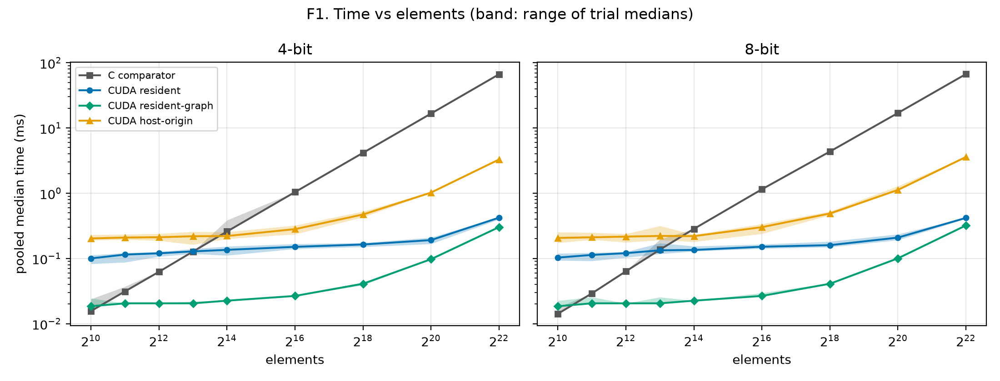
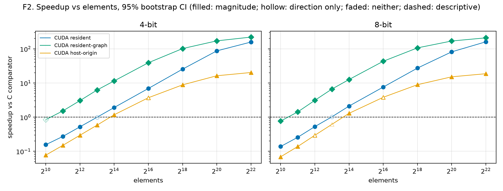
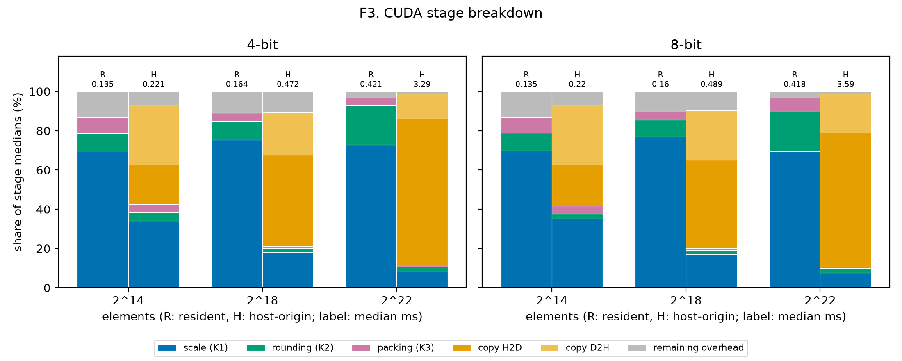
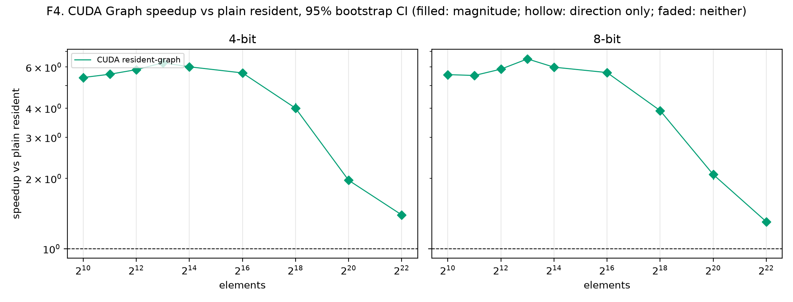

# Size sweep report (2026-11-17-3feab89)

Generated by `bench_report.py` from snapshot revision `3feab89`, 72 cases, all passed: True.

## Crossover

Located from the direction claim on both sides of the flip.

- CUDA resident, 4-bit: not resolved (largest supported slower size: 2^12; smallest supported faster size: 2^14).
- CUDA resident-graph, 4-bit: not resolved (largest supported slower size: none; smallest supported faster size: 2^11).
- CUDA host-origin, 4-bit: resolved between 2^13 and 2^14 elements (slower to faster).
- CUDA resident, 8-bit: not resolved (largest supported slower size: 2^12; smallest supported faster size: 2^14).
- CUDA resident-graph, 8-bit: resolved between 2^10 and 2^11 elements (slower to faster).
- CUDA host-origin, 8-bit: not resolved (largest supported slower size: 2^12; smallest supported faster size: 2^14).

### Revision 2 crossover

Located from the unchanged revision 2 claim, for comparison.

- CUDA resident, 4-bit: not resolved (largest supported slower size: 2^12; smallest supported faster size: 2^16).
- CUDA resident-graph, 4-bit: not resolved (largest supported slower size: none; smallest supported faster size: 2^11).
- CUDA host-origin, 4-bit: not resolved (largest supported slower size: 2^11; smallest supported faster size: 2^18).
- CUDA resident, 8-bit: not resolved (largest supported slower size: 2^12; smallest supported faster size: 2^14).
- CUDA resident-graph, 8-bit: not resolved (largest supported slower size: none; smallest supported faster size: 2^11).
- CUDA host-origin, 8-bit: not resolved (largest supported slower size: none; smallest supported faster size: 2^18).

## T1. Summary

Times are pooled medians. Speedup is C median over CUDA median. The trial range decides the verdict; the 95% CI is the bootstrap interval over trial medians, so a speedup can lie outside its CI. Direction, magnitude and revision 2 are the claim rules recorded in the manifest; — marks a field the snapshot predates.

| Elements | Bits | Path | C (ms) | CUDA (ms) | Speedup | Trial range | 95% CI | Verdict | Direction | Magnitude | Rev 2 |
|---|---|---|---|---|---|---|---|---|---|---|---|
| 2^10 | 4 | CUDA resident | 0.0156 | 0.1001 | 0.156× | [0.138, 0.288] | [0.147, 0.157] | slower | yes | yes | no |
| 2^10 | 4 | CUDA resident-graph | 0.0156 | 0.0185 | 0.843× | [0.633, 1.29] | [0.801, 0.843] | inconclusive | no | no | no |
| 2^10 | 4 | CUDA host-origin | 0.0156 | 0.2023 | 0.0771× | [0.0673, 0.126] | [0.0756, 0.0801] | slower | yes | yes | no |
| 2^10 | 8 | CUDA resident | 0.0142 | 0.103 | 0.138× | [0.119, 0.191] | [0.135, 0.143] | slower | yes | yes | no |
| 2^10 | 8 | CUDA resident-graph | 0.0142 | 0.0185 | 0.768× | [0.631, 0.967] | [0.749, 0.769] | slower | yes | yes | no |
| 2^10 | 8 | CUDA host-origin | 0.0142 | 0.2062 | 0.0689× | [0.056, 0.103] | [0.0668, 0.0727] | slower | yes | yes | no |
| 2^11 | 4 | CUDA resident | 0.0312 | 0.1145 | 0.272× | [0.255, 0.425] | [0.267, 0.281] | slower | yes | yes | no |
| 2^11 | 4 | CUDA resident-graph | 0.0312 | 0.0205 | 1.52× | [1.52, 1.82] | [1.52, 1.52] | faster | yes | yes | yes |
| 2^11 | 4 | CUDA host-origin | 0.0312 | 0.2089 | 0.149× | [0.133, 0.191] | [0.148, 0.151] | slower | yes | yes | yes |
| 2^11 | 8 | CUDA resident | 0.0291 | 0.1132 | 0.257× | [0.237, 0.318] | [0.249, 0.265] | slower | yes | yes | no |
| 2^11 | 8 | CUDA resident-graph | 0.0291 | 0.0205 | 1.42× | [1.14, 1.43] | [1.42, 1.42] | faster | yes | yes | yes |
| 2^11 | 8 | CUDA host-origin | 0.0291 | 0.2108 | 0.138× | [0.116, 0.15] | [0.136, 0.14] | slower | yes | yes | no |
| 2^12 | 4 | CUDA resident | 0.0624 | 0.1199 | 0.521× | [0.491, 0.59] | [0.514, 0.529] | slower | yes | yes | yes |
| 2^12 | 4 | CUDA resident-graph | 0.0624 | 0.0205 | 3.04× | [3.04, 3.1] | [3.04, 3.05] | faster | yes | yes | yes |
| 2^12 | 4 | CUDA host-origin | 0.0624 | 0.2113 | 0.295× | [0.26, 0.337] | [0.287, 0.298] | slower | yes | yes | no |
| 2^12 | 8 | CUDA resident | 0.0635 | 0.1205 | 0.527× | [0.5, 0.616] | [0.516, 0.532] | slower | yes | yes | yes |
| 2^12 | 8 | CUDA resident-graph | 0.0635 | 0.0205 | 3.1× | [3.09, 3.12] | [3.1, 3.11] | faster | yes | yes | yes |
| 2^12 | 8 | CUDA host-origin | 0.0635 | 0.216 | 0.294× | [0.266, 0.361] | [0.286, 0.299] | slower | yes | no | no |
| 2^13 | 4 | CUDA resident | 0.1275 | 0.1283 | 0.994× | [0.905, 1.08] | [0.977, 1.01] | inconclusive | no | no | no |
| 2^13 | 4 | CUDA resident-graph | 0.1275 | 0.0205 | 6.22× | [5.79, 6.22] | [6.21, 6.22] | faster | yes | yes | yes |
| 2^13 | 4 | CUDA host-origin | 0.1275 | 0.2188 | 0.583× | [0.495, 0.784] | [0.575, 0.605] | slower | yes | yes | no |
| 2^13 | 8 | CUDA resident | 0.1362 | 0.1332 | 1.02× | [0.791, 1.67] | [1.02, 1.06] | inconclusive | no | no | no |
| 2^13 | 8 | CUDA resident-graph | 0.1362 | 0.0205 | 6.64× | [5.33, 9.57] | [6.61, 6.65] | faster | yes | yes | no |
| 2^13 | 8 | CUDA host-origin | 0.1362 | 0.2212 | 0.616× | [0.43, 1.03] | [0.608, 0.661] | inconclusive | no | no | no |
| 2^14 | 4 | CUDA resident | 0.2586 | 0.1353 | 1.91× | [1.69, 3.47] | [1.88, 1.93] | faster | yes | yes | no |
| 2^14 | 4 | CUDA resident-graph | 0.2586 | 0.0225 | 11.5× | [11.5, 17.2] | [11.5, 11.5] | faster | yes | yes | no |
| 2^14 | 4 | CUDA host-origin | 0.2586 | 0.2205 | 1.17× | [1.01, 1.93] | [1.15, 1.21] | faster | yes | yes | no |
| 2^14 | 8 | CUDA resident | 0.2837 | 0.1348 | 2.1× | [1.84, 2.2] | [2.09, 2.14] | faster | yes | yes | yes |
| 2^14 | 8 | CUDA resident-graph | 0.2837 | 0.0225 | 12.6× | [12.6, 12.6] | [12.6, 12.6] | faster | yes | yes | yes |
| 2^14 | 8 | CUDA host-origin | 0.2837 | 0.2196 | 1.29× | [1.22, 1.58] | [1.27, 1.34] | faster | yes | yes | no |
| 2^16 | 4 | CUDA resident | 1.04 | 0.1506 | 6.91× | [6.22, 7.42] | [6.73, 7.16] | faster | yes | yes | yes |
| 2^16 | 4 | CUDA resident-graph | 1.04 | 0.0266 | 39.1× | [38.4, 39.1] | [39.1, 39.1] | faster | yes | yes | yes |
| 2^16 | 4 | CUDA host-origin | 1.04 | 0.2812 | 3.7× | [3.24, 4.42] | [3.5, 3.99] | faster | yes | no | no |
| 2^16 | 8 | CUDA resident | 1.148 | 0.1511 | 7.6× | [6.96, 8.13] | [7.54, 7.92] | faster | yes | yes | yes |
| 2^16 | 8 | CUDA resident-graph | 1.148 | 0.0266 | 43.2× | [38.7, 43.3] | [43.2, 43.2] | faster | yes | yes | yes |
| 2^16 | 8 | CUDA host-origin | 1.148 | 0.3015 | 3.81× | [3.39, 4.82] | [3.66, 3.98] | faster | yes | no | no |
| 2^18 | 4 | CUDA resident | 4.155 | 0.1635 | 25.4× | [23.9, 27.7] | [24.5, 26.2] | faster | yes | yes | yes |
| 2^18 | 4 | CUDA resident-graph | 4.155 | 0.0409 | 102× | [96.6, 107] | [102, 105] | faster | yes | yes | yes |
| 2^18 | 4 | CUDA host-origin | 4.155 | 0.4716 | 8.81× | [7.9, 9.67] | [8.38, 8.98] | faster | yes | yes | yes |
| 2^18 | 8 | CUDA resident | 4.354 | 0.1597 | 27.3× | [23.9, 29.2] | [26.9, 27.8] | faster | yes | yes | yes |
| 2^18 | 8 | CUDA resident-graph | 4.354 | 0.0409 | 106× | [104, 107] | [106, 106] | faster | yes | yes | yes |
| 2^18 | 8 | CUDA host-origin | 4.354 | 0.4889 | 8.91× | [8.28, 9.44] | [8.73, 9.21] | faster | yes | yes | yes |
| 2^20 | 4 | CUDA resident | 16.62 | 0.191 | 87× | [79.3, 101] | [86.1, 87.9] | faster | yes | yes | no |
| 2^20 | 4 | CUDA resident-graph | 16.62 | 0.0973 | 171× | [171, 175] | [171, 171] | faster | yes | yes | yes |
| 2^20 | 4 | CUDA host-origin | 16.62 | 1.022 | 16.3× | [15.9, 16.8] | [16.2, 16.3] | faster | yes | yes | yes |
| 2^20 | 8 | CUDA resident | 16.97 | 0.2086 | 81.4× | [72.2, 89.7] | [79.4, 85.6] | faster | yes | yes | yes |
| 2^20 | 8 | CUDA resident-graph | 16.97 | 0.1003 | 169× | [167, 173] | [168, 171] | faster | yes | yes | yes |
| 2^20 | 8 | CUDA host-origin | 16.97 | 1.122 | 15.1× | [13.2, 15.4] | [15.1, 15.2] | faster | yes | yes | yes |
| 2^22 | 4 | CUDA resident | 66.5 | 0.4215 | 158× | [154, 168] | [156, 159] | faster | yes | yes | yes |
| 2^22 | 4 | CUDA resident-graph | 66.5 | 0.302 | 220× | [220, 223] | [220, 220] | faster | yes | yes | yes |
| 2^22 | 4 | CUDA host-origin | 66.5 | 3.285 | 20.2× | [19.3, 20.5] | [20.2, 20.3] | faster | yes | yes | yes |
| 2^22 | 8 | CUDA resident | 67.05 | 0.4183 | 160× | [159, 165] | [160, 161] | faster | yes | yes | yes |
| 2^22 | 8 | CUDA resident-graph | 67.05 | 0.3205 | 209× | [208, 210] | [209, 209] | faster | yes | yes | yes |
| 2^22 | 8 | CUDA host-origin | 67.05 | 3.593 | 18.7× | [18.4, 18.7] | [18.7, 18.7] | faster | yes | yes | yes |

## Figures

- 
- 
- 
- 
