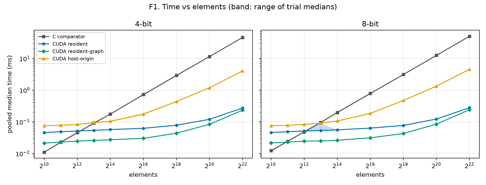
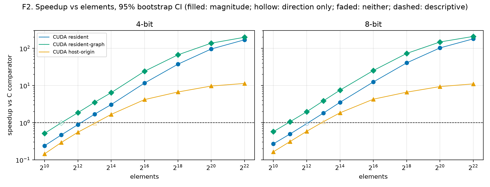
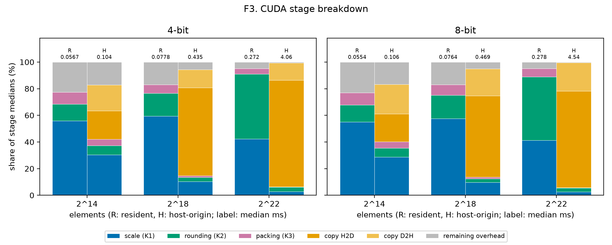
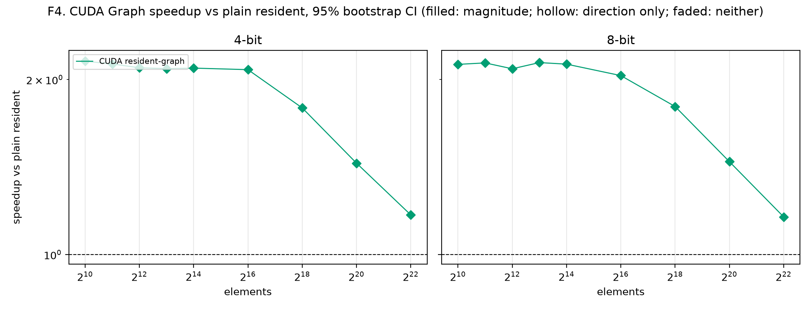

# Size sweep report (2026-11-17-9446386-hub-a100)

Generated by `bench_report.py` from snapshot revision `9446386`, 72 cases, all passed: True.

## Crossover

Located from the direction claim on both sides of the flip.

- CUDA resident, 4-bit: resolved between 2^12 and 2^13 elements (slower to faster).
- CUDA resident-graph, 4-bit: not resolved (largest supported slower size: 2^10; smallest supported faster size: 2^12).
- CUDA host-origin, 4-bit: not resolved (largest supported slower size: 2^12; smallest supported faster size: 2^14).
- CUDA resident, 8-bit: not resolved (largest supported slower size: 2^11; smallest supported faster size: 2^13).
- CUDA resident-graph, 8-bit: resolved between 2^10 and 2^11 elements (slower to faster).
- CUDA host-origin, 8-bit: not resolved (largest supported slower size: 2^12; smallest supported faster size: 2^14).

### Revision 2 crossover

Located from the unchanged revision 2 claim, for comparison.

- CUDA resident, 4-bit: resolved between 2^12 and 2^13 elements (slower to faster).
- CUDA resident-graph, 4-bit: not resolved (largest supported slower size: 2^10; smallest supported faster size: 2^12).
- CUDA host-origin, 4-bit: not resolved (largest supported slower size: 2^12; smallest supported faster size: 2^14).
- CUDA resident, 8-bit: not resolved (largest supported slower size: 2^11; smallest supported faster size: 2^14).
- CUDA resident-graph, 8-bit: resolved between 2^10 and 2^11 elements (slower to faster).
- CUDA host-origin, 8-bit: not resolved (largest supported slower size: 2^12; smallest supported faster size: 2^14).

## T1. Summary

Times are pooled medians. Speedup is C median over CUDA median. The trial range decides the verdict; the 95% CI is the bootstrap interval over trial medians, so a speedup can lie outside its CI. Direction, magnitude and revision 2 are the claim rules recorded in the manifest; — marks a field the snapshot predates.

| Elements | Bits | Path | C (ms) | CUDA (ms) | Speedup | Trial range | 95% CI | Verdict | Direction | Magnitude | Rev 2 |
|---|---|---|---|---|---|---|---|---|---|---|---|
| 2^10 | 4 | CUDA resident | 0.01088 | 0.0454 | 0.24× | [0.235, 0.26] | [0.238, 0.251] | slower | yes | yes | yes |
| 2^10 | 4 | CUDA resident-graph | 0.01088 | 0.02112 | 0.515× | [0.51, 0.556] | [0.513, 0.54] | slower | yes | yes | yes |
| 2^10 | 4 | CUDA host-origin | 0.01088 | 0.07516 | 0.145× | [0.143, 0.158] | [0.144, 0.152] | slower | yes | yes | yes |
| 2^10 | 8 | CUDA resident | 0.01232 | 0.04571 | 0.27× | [0.244, 0.288] | [0.263, 0.271] | slower | yes | yes | yes |
| 2^10 | 8 | CUDA resident-graph | 0.01232 | 0.02153 | 0.572× | [0.512, 0.607] | [0.56, 0.575] | slower | yes | yes | yes |
| 2^10 | 8 | CUDA host-origin | 0.01232 | 0.07488 | 0.165× | [0.142, 0.177] | [0.161, 0.166] | slower | yes | yes | yes |
| 2^11 | 4 | CUDA resident | 0.02266 | 0.04859 | 0.466× | [0.426, 0.49] | [0.443, 0.471] | slower | yes | yes | yes |
| 2^11 | 4 | CUDA resident-graph | 0.02266 | 0.02285 | 0.992× | [0.905, 1.03] | [0.943, 0.995] | inconclusive | no | no | no |
| 2^11 | 4 | CUDA host-origin | 0.02266 | 0.07763 | 0.292× | [0.254, 0.306] | [0.278, 0.294] | slower | yes | yes | yes |
| 2^11 | 8 | CUDA resident | 0.02406 | 0.04858 | 0.495× | [0.474, 0.543] | [0.492, 0.509] | slower | yes | yes | yes |
| 2^11 | 8 | CUDA resident-graph | 0.02406 | 0.02275 | 1.06× | [1.02, 1.14] | [1.05, 1.08] | faster | yes | yes | yes |
| 2^11 | 8 | CUDA host-origin | 0.02406 | 0.07758 | 0.31× | [0.293, 0.338] | [0.307, 0.319] | slower | yes | yes | yes |
| 2^12 | 4 | CUDA resident | 0.04519 | 0.05101 | 0.886× | [0.816, 0.926] | [0.842, 0.893] | slower | yes | yes | yes |
| 2^12 | 4 | CUDA resident-graph | 0.04519 | 0.02435 | 1.86× | [1.71, 1.92] | [1.77, 1.86] | faster | yes | yes | yes |
| 2^12 | 4 | CUDA host-origin | 0.04519 | 0.0817 | 0.553× | [0.482, 0.579] | [0.527, 0.557] | slower | yes | yes | yes |
| 2^12 | 8 | CUDA resident | 0.0479 | 0.05085 | 0.942× | [0.89, 1.03] | [0.929, 0.972] | inconclusive | no | no | no |
| 2^12 | 8 | CUDA resident-graph | 0.0479 | 0.02437 | 1.97× | [1.89, 2.13] | [1.96, 2.02] | faster | yes | yes | yes |
| 2^12 | 8 | CUDA host-origin | 0.0479 | 0.08192 | 0.585× | [0.52, 0.641] | [0.579, 0.6] | slower | yes | yes | yes |
| 2^13 | 4 | CUDA resident | 0.09052 | 0.0536 | 1.69× | [1.55, 1.77] | [1.62, 1.7] | faster | yes | yes | yes |
| 2^13 | 4 | CUDA resident-graph | 0.09052 | 0.02567 | 3.53× | [3.29, 3.65] | [3.36, 3.53] | faster | yes | yes | yes |
| 2^13 | 4 | CUDA host-origin | 0.09052 | 0.09437 | 0.959× | [0.885, 1.06] | [0.914, 0.962] | inconclusive | no | no | no |
| 2^13 | 8 | CUDA resident | 0.09557 | 0.05287 | 1.81× | [1.03, 1.94] | [1.78, 1.85] | faster | yes | yes | no |
| 2^13 | 8 | CUDA resident-graph | 0.09557 | 0.02472 | 3.87× | [3.61, 4.09] | [3.82, 3.94] | faster | yes | yes | yes |
| 2^13 | 8 | CUDA host-origin | 0.09557 | 0.09009 | 1.06× | [0.942, 1.14] | [1.01, 1.09] | inconclusive | no | no | no |
| 2^14 | 4 | CUDA resident | 0.174 | 0.05671 | 3.07× | [3, 3.33] | [3.02, 3.19] | faster | yes | yes | yes |
| 2^14 | 4 | CUDA resident-graph | 0.174 | 0.02711 | 6.42× | [6.22, 6.89] | [6.35, 6.67] | faster | yes | yes | yes |
| 2^14 | 4 | CUDA host-origin | 0.174 | 0.104 | 1.67× | [1.63, 1.91] | [1.65, 1.74] | faster | yes | yes | yes |
| 2^14 | 8 | CUDA resident | 0.1958 | 0.05542 | 3.53× | [3.3, 3.68] | [3.47, 3.63] | faster | yes | yes | yes |
| 2^14 | 8 | CUDA resident-graph | 0.1958 | 0.02608 | 7.51× | [7.01, 7.74] | [7.36, 7.68] | faster | yes | yes | yes |
| 2^14 | 8 | CUDA host-origin | 0.1958 | 0.1063 | 1.84× | [1.73, 1.99] | [1.81, 1.88] | faster | yes | yes | yes |
| 2^16 | 4 | CUDA resident | 0.7224 | 0.06205 | 11.6× | [11, 12.3] | [11.1, 11.9] | faster | yes | yes | yes |
| 2^16 | 4 | CUDA resident-graph | 0.7224 | 0.02984 | 24.2× | [22.7, 25.2] | [23.2, 24.5] | faster | yes | yes | yes |
| 2^16 | 4 | CUDA host-origin | 0.7224 | 0.173 | 4.18× | [3.57, 4.48] | [3.99, 4.25] | faster | yes | yes | yes |
| 2^16 | 8 | CUDA resident | 0.7855 | 0.06304 | 12.5× | [11.6, 13.1] | [12.1, 12.6] | faster | yes | yes | yes |
| 2^16 | 8 | CUDA resident-graph | 0.7855 | 0.03104 | 25.3× | [23.9, 26.4] | [24.7, 25.4] | faster | yes | yes | yes |
| 2^16 | 8 | CUDA host-origin | 0.7855 | 0.1835 | 4.28× | [4.02, 4.59] | [4.17, 4.31] | faster | yes | yes | yes |
| 2^18 | 4 | CUDA resident | 2.909 | 0.0778 | 37.4× | [35, 39.3] | [36.2, 38.1] | faster | yes | yes | yes |
| 2^18 | 4 | CUDA resident-graph | 2.909 | 0.04354 | 66.8× | [62.8, 69.2] | [64.9, 67.9] | faster | yes | yes | yes |
| 2^18 | 4 | CUDA host-origin | 2.909 | 0.435 | 6.69× | [6.22, 7.06] | [6.49, 6.81] | faster | yes | yes | yes |
| 2^18 | 8 | CUDA resident | 3.102 | 0.0764 | 40.6× | [39, 43] | [39.9, 41.3] | faster | yes | yes | yes |
| 2^18 | 8 | CUDA resident-graph | 3.102 | 0.04252 | 73× | [70.4, 76.4] | [72, 73.8] | faster | yes | yes | yes |
| 2^18 | 8 | CUDA host-origin | 3.102 | 0.4689 | 6.62× | [6.36, 7.01] | [6.52, 6.7] | faster | yes | yes | yes |
| 2^20 | 4 | CUDA resident | 11.44 | 0.1192 | 96× | [92.9, 101] | [95, 96.9] | faster | yes | yes | yes |
| 2^20 | 4 | CUDA resident-graph | 11.44 | 0.08302 | 138× | [135, 143] | [136, 139] | faster | yes | yes | yes |
| 2^20 | 4 | CUDA host-origin | 11.44 | 1.182 | 9.68× | [9.34, 10.2] | [9.57, 9.78] | faster | yes | yes | yes |
| 2^20 | 8 | CUDA resident | 12.5 | 0.1216 | 103× | [99.8, 110] | [102, 104] | faster | yes | yes | yes |
| 2^20 | 8 | CUDA resident-graph | 12.5 | 0.08422 | 148× | [145, 156] | [148, 149] | faster | yes | yes | yes |
| 2^20 | 8 | CUDA host-origin | 12.5 | 1.336 | 9.36× | [9.07, 10] | [9.29, 9.41] | faster | yes | yes | yes |
| 2^22 | 4 | CUDA resident | 46.14 | 0.2717 | 170× | [166, 176] | [168, 172] | faster | yes | yes | yes |
| 2^22 | 4 | CUDA resident-graph | 46.14 | 0.2323 | 199× | [194, 205] | [196, 201] | faster | yes | yes | yes |
| 2^22 | 4 | CUDA host-origin | 46.14 | 4.058 | 11.4× | [10.8, 12] | [11.2, 11.5] | faster | yes | yes | yes |
| 2^22 | 8 | CUDA resident | 50.14 | 0.278 | 180× | [176, 186] | [178, 182] | faster | yes | yes | yes |
| 2^22 | 8 | CUDA resident-graph | 50.14 | 0.2395 | 209× | [205, 215] | [208, 211] | faster | yes | yes | yes |
| 2^22 | 8 | CUDA host-origin | 50.14 | 4.535 | 11.1× | [10.6, 11.5] | [11, 11.1] | faster | yes | yes | yes |

## Figures

- 
- 
- 
- 
