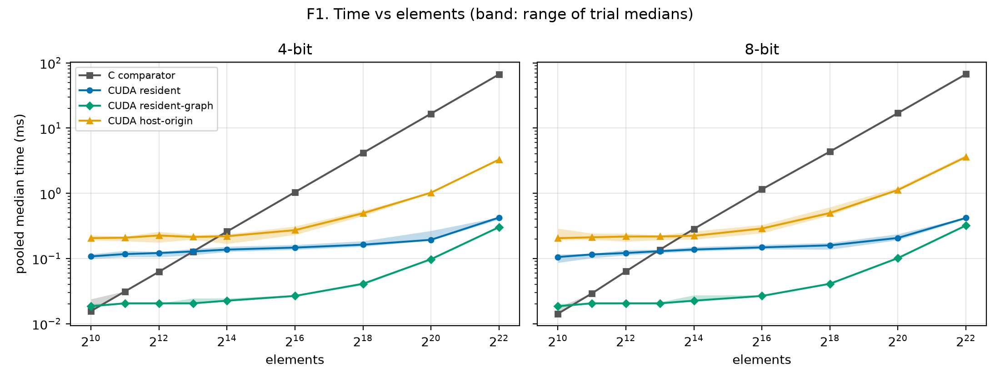
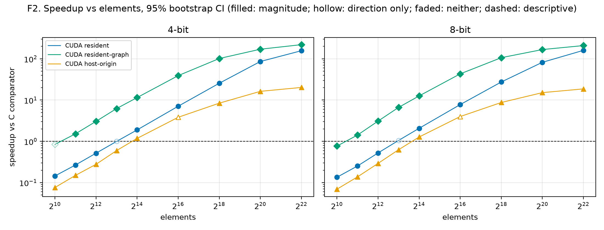
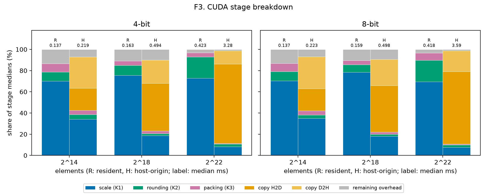
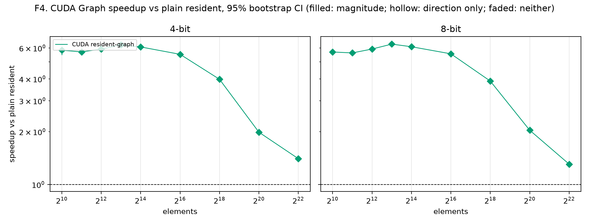

# Size sweep report (2026-11-17-fbeede0)

Generated by `bench_report.py` from snapshot revision `fbeede0`, 72 cases, all passed: True.

## Crossover

Located from the direction claim on both sides of the flip.

- CUDA resident, 4-bit: not resolved (largest supported slower size: 2^12; smallest supported faster size: 2^14).
- CUDA resident-graph, 4-bit: not resolved (largest supported slower size: none; smallest supported faster size: 2^11).
- CUDA host-origin, 4-bit: resolved between 2^13 and 2^14 elements (slower to faster).
- CUDA resident, 8-bit: not resolved (largest supported slower size: 2^12; smallest supported faster size: 2^14).
- CUDA resident-graph, 8-bit: resolved between 2^10 and 2^11 elements (slower to faster).
- CUDA host-origin, 8-bit: resolved between 2^13 and 2^14 elements (slower to faster).

### Revision 2 crossover

Located from the unchanged revision 2 claim, for comparison.

- CUDA resident, 4-bit: not resolved (largest supported slower size: 2^12; smallest supported faster size: 2^14).
- CUDA resident-graph, 4-bit: not resolved (largest supported slower size: none; smallest supported faster size: 2^11).
- CUDA host-origin, 4-bit: not resolved (largest supported slower size: 2^13; smallest supported faster size: 2^18).
- CUDA resident, 8-bit: not resolved (largest supported slower size: 2^12; smallest supported faster size: 2^14).
- CUDA resident-graph, 8-bit: not resolved (largest supported slower size: none; smallest supported faster size: 2^11).
- CUDA host-origin, 8-bit: not resolved (largest supported slower size: 2^13; smallest supported faster size: 2^20).

## T1. Summary

Times are pooled medians. Speedup is C median over CUDA median. The trial range decides the verdict; the 95% CI is the bootstrap interval over trial medians, so a speedup can lie outside its CI. Direction, magnitude and revision 2 are the claim rules recorded in the manifest; — marks a field the snapshot predates.

| Elements | Bits | Path | C (ms) | CUDA (ms) | Speedup | Trial range | 95% CI | Verdict | Direction | Magnitude | Rev 2 |
|---|---|---|---|---|---|---|---|---|---|---|---|
| 2^10 | 4 | CUDA resident | 0.0156 | 0.1077 | 0.145× | [0.133, 0.243] | [0.142, 0.15] | slower | yes | yes | no |
| 2^10 | 4 | CUDA resident-graph | 0.0156 | 0.0185 | 0.843× | [0.765, 1.3] | [0.805, 0.843] | inconclusive | no | no | no |
| 2^10 | 4 | CUDA host-origin | 0.0156 | 0.2051 | 0.0761× | [0.0683, 0.125] | [0.0742, 0.0777] | slower | yes | yes | no |
| 2^10 | 8 | CUDA resident | 0.0142 | 0.1052 | 0.135× | [0.123, 0.207] | [0.13, 0.138] | slower | yes | yes | no |
| 2^10 | 8 | CUDA resident-graph | 0.0142 | 0.0185 | 0.768× | [0.7, 0.967] | [0.761, 0.77] | slower | yes | yes | no |
| 2^10 | 8 | CUDA host-origin | 0.0142 | 0.2047 | 0.0694× | [0.0493, 0.0936] | [0.0685, 0.0717] | slower | yes | yes | no |
| 2^11 | 4 | CUDA resident | 0.0312 | 0.1167 | 0.267× | [0.237, 0.298] | [0.262, 0.273] | slower | yes | yes | yes |
| 2^11 | 4 | CUDA resident-graph | 0.0312 | 0.0205 | 1.52× | [1.51, 1.54] | [1.52, 1.52] | faster | yes | yes | yes |
| 2^11 | 4 | CUDA host-origin | 0.0312 | 0.2081 | 0.15× | [0.142, 0.17] | [0.147, 0.152] | slower | yes | yes | yes |
| 2^11 | 8 | CUDA resident | 0.0291 | 0.1152 | 0.253× | [0.243, 0.287] | [0.248, 0.257] | slower | yes | yes | yes |
| 2^11 | 8 | CUDA resident-graph | 0.0291 | 0.0205 | 1.42× | [1.41, 1.43] | [1.42, 1.42] | faster | yes | yes | yes |
| 2^11 | 8 | CUDA host-origin | 0.0291 | 0.2111 | 0.138× | [0.119, 0.15] | [0.137, 0.139] | slower | yes | yes | no |
| 2^12 | 4 | CUDA resident | 0.0625 | 0.1212 | 0.516× | [0.489, 0.595] | [0.506, 0.533] | slower | yes | yes | yes |
| 2^12 | 4 | CUDA resident-graph | 0.0625 | 0.0205 | 3.05× | [3.04, 3.07] | [3.04, 3.05] | faster | yes | yes | yes |
| 2^12 | 4 | CUDA host-origin | 0.0625 | 0.2251 | 0.278× | [0.242, 0.355] | [0.264, 0.286] | slower | yes | yes | no |
| 2^12 | 8 | CUDA resident | 0.0634 | 0.1212 | 0.523× | [0.468, 0.569] | [0.509, 0.533] | slower | yes | yes | yes |
| 2^12 | 8 | CUDA resident-graph | 0.0634 | 0.0205 | 3.09× | [3.09, 3.12] | [3.09, 3.1] | faster | yes | yes | yes |
| 2^12 | 8 | CUDA host-origin | 0.0634 | 0.217 | 0.292× | [0.262, 0.35] | [0.283, 0.297] | slower | yes | yes | no |
| 2^13 | 4 | CUDA resident | 0.1275 | 0.128 | 0.996× | [0.907, 1.14] | [0.983, 1.03] | inconclusive | no | no | no |
| 2^13 | 4 | CUDA resident-graph | 0.1275 | 0.0205 | 6.22× | [5.2, 6.28] | [6.21, 6.22] | faster | yes | yes | yes |
| 2^13 | 4 | CUDA host-origin | 0.1275 | 0.2135 | 0.597× | [0.552, 0.655] | [0.587, 0.611] | slower | yes | yes | yes |
| 2^13 | 8 | CUDA resident | 0.1362 | 0.1293 | 1.05× | [0.991, 1.13] | [1.04, 1.07] | inconclusive | no | no | no |
| 2^13 | 8 | CUDA resident-graph | 0.1362 | 0.0205 | 6.64× | [6.33, 6.71] | [6.64, 6.65] | faster | yes | yes | yes |
| 2^13 | 8 | CUDA host-origin | 0.1362 | 0.2172 | 0.627× | [0.597, 0.712] | [0.612, 0.647] | slower | yes | yes | yes |
| 2^14 | 4 | CUDA resident | 0.2586 | 0.1367 | 1.89× | [1.7, 2.04] | [1.86, 1.91] | faster | yes | yes | yes |
| 2^14 | 4 | CUDA resident-graph | 0.2586 | 0.0225 | 11.5× | [10.6, 11.5] | [11.5, 11.5] | faster | yes | yes | yes |
| 2^14 | 4 | CUDA host-origin | 0.2586 | 0.2193 | 1.18× | [1.1, 1.54] | [1.16, 1.21] | faster | yes | yes | no |
| 2^14 | 8 | CUDA resident | 0.2837 | 0.1371 | 2.07× | [1.88, 2.21] | [2.05, 2.11] | faster | yes | yes | yes |
| 2^14 | 8 | CUDA resident-graph | 0.2837 | 0.0225 | 12.6× | [10.4, 12.7] | [12.6, 12.6] | faster | yes | yes | yes |
| 2^14 | 8 | CUDA host-origin | 0.2837 | 0.2226 | 1.27× | [1.09, 1.45] | [1.24, 1.36] | faster | yes | yes | no |
| 2^16 | 4 | CUDA resident | 1.04 | 0.1467 | 7.09× | [6.42, 7.64] | [6.93, 7.21] | faster | yes | yes | yes |
| 2^16 | 4 | CUDA resident-graph | 1.04 | 0.0266 | 39.1× | [37.7, 39.1] | [39.1, 39.1] | faster | yes | yes | yes |
| 2^16 | 4 | CUDA host-origin | 1.04 | 0.2717 | 3.83× | [3.34, 4.52] | [3.53, 4.24] | faster | yes | no | no |
| 2^16 | 8 | CUDA resident | 1.148 | 0.1477 | 7.77× | [7.06, 8.27] | [7.63, 7.93] | faster | yes | yes | yes |
| 2^16 | 8 | CUDA resident-graph | 1.148 | 0.0266 | 43.2× | [41.9, 43.2] | [43.2, 43.2] | faster | yes | yes | yes |
| 2^16 | 8 | CUDA host-origin | 1.148 | 0.2877 | 3.99× | [3.5, 4.71] | [3.72, 4.28] | faster | yes | no | no |
| 2^18 | 4 | CUDA resident | 4.156 | 0.1626 | 25.6× | [22.4, 27.4] | [25.1, 26.3] | faster | yes | yes | yes |
| 2^18 | 4 | CUDA resident-graph | 4.156 | 0.0409 | 102× | [101, 107] | [102, 102] | faster | yes | yes | yes |
| 2^18 | 4 | CUDA host-origin | 4.156 | 0.4937 | 8.42× | [7.67, 9.28] | [8.24, 8.59] | faster | yes | yes | yes |
| 2^18 | 8 | CUDA resident | 4.355 | 0.1588 | 27.4× | [25, 31.8] | [26.6, 27.6] | faster | yes | yes | no |
| 2^18 | 8 | CUDA resident-graph | 4.355 | 0.0409 | 106× | [106, 107] | [106, 106] | faster | yes | yes | yes |
| 2^18 | 8 | CUDA host-origin | 4.355 | 0.4982 | 8.74× | [7.1, 9.55] | [8.56, 9] | faster | yes | yes | no |
| 2^20 | 4 | CUDA resident | 16.62 | 0.1931 | 86.1× | [62.5, 88] | [85.8, 86.5] | faster | yes | yes | no |
| 2^20 | 4 | CUDA resident-graph | 16.62 | 0.0973 | 171× | [171, 171] | [171, 171] | faster | yes | yes | yes |
| 2^20 | 4 | CUDA host-origin | 16.62 | 1.021 | 16.3× | [16, 16.5] | [16.2, 16.3] | faster | yes | yes | yes |
| 2^20 | 8 | CUDA resident | 16.97 | 0.2064 | 82.2× | [71.7, 89.2] | [80.1, 83.9] | faster | yes | yes | yes |
| 2^20 | 8 | CUDA resident-graph | 16.97 | 0.1013 | 168× | [167, 172] | [167, 169] | faster | yes | yes | yes |
| 2^20 | 8 | CUDA host-origin | 16.97 | 1.121 | 15.1× | [13.9, 15.3] | [15, 15.2] | faster | yes | yes | yes |
| 2^22 | 4 | CUDA resident | 66.49 | 0.4235 | 157× | [155, 168] | [156, 161] | faster | yes | yes | yes |
| 2^22 | 4 | CUDA resident-graph | 66.49 | 0.302 | 220× | [220, 223] | [220, 220] | faster | yes | yes | yes |
| 2^22 | 4 | CUDA host-origin | 66.49 | 3.284 | 20.2× | [20, 20.5] | [20.2, 20.3] | faster | yes | yes | yes |
| 2^22 | 8 | CUDA resident | 67.06 | 0.4184 | 160× | [157, 167] | [160, 161] | faster | yes | yes | yes |
| 2^22 | 8 | CUDA resident-graph | 67.06 | 0.3205 | 209× | [208, 210] | [208, 209] | faster | yes | yes | yes |
| 2^22 | 8 | CUDA host-origin | 67.06 | 3.595 | 18.7× | [17.2, 18.9] | [18.6, 18.7] | faster | yes | yes | yes |

## Figures

- 
- 
- 
- 
