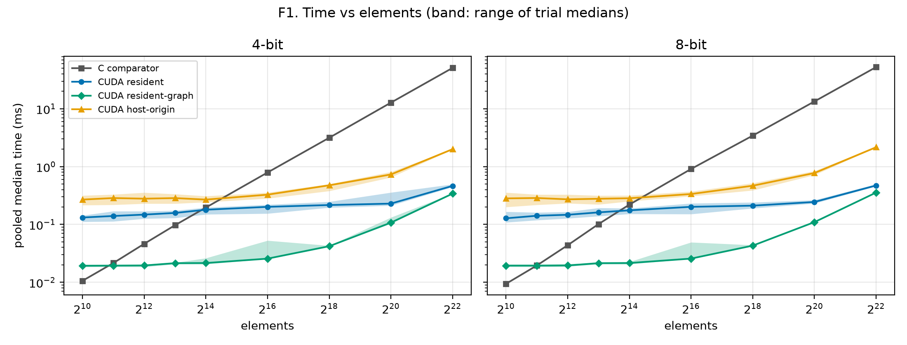
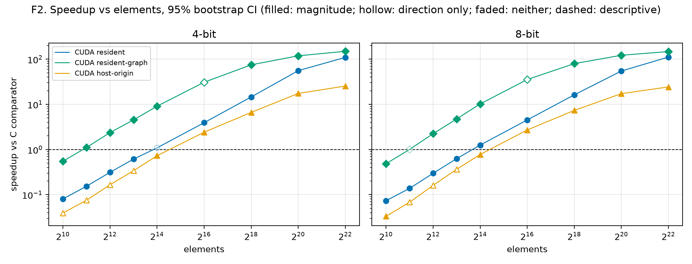
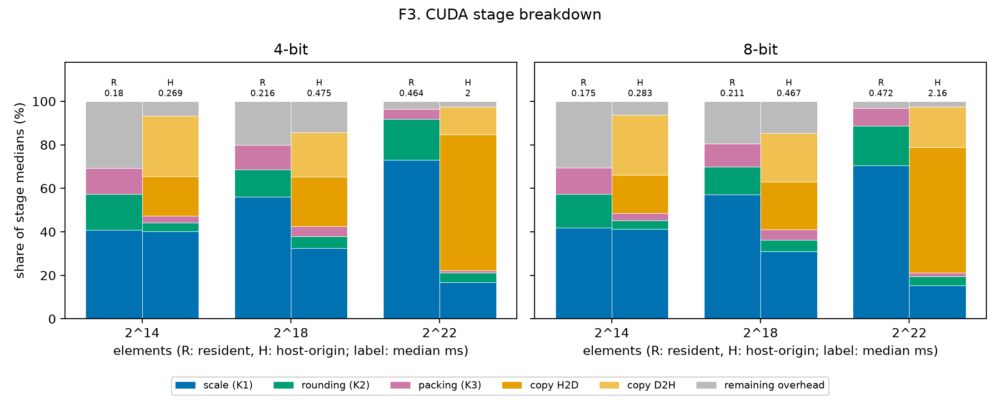
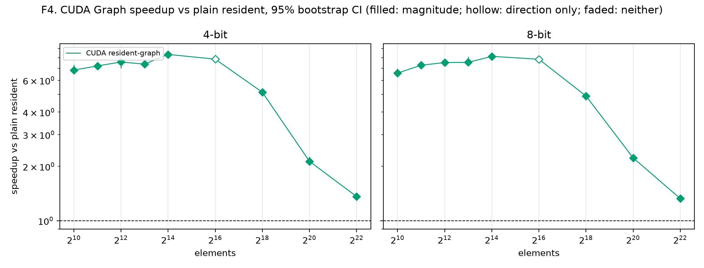

# Size sweep report (2026-11-26-5c4e64f-chan-run1)

Generated by `bench_report.py` from snapshot revision `5c4e64f`, 72 cases, all passed: True.

## Crossover

Located from the direction claim on both sides of the flip.

- CUDA resident, 4-bit: not resolved (largest supported slower size: 2^13; smallest supported faster size: 2^16).
- CUDA resident-graph, 4-bit: resolved between 2^10 and 2^11 elements (slower to faster).
- CUDA host-origin, 4-bit: resolved between 2^14 and 2^16 elements (slower to faster).
- CUDA resident, 8-bit: resolved between 2^13 and 2^14 elements (slower to faster).
- CUDA resident-graph, 8-bit: not resolved (largest supported slower size: 2^10; smallest supported faster size: 2^12).
- CUDA host-origin, 8-bit: resolved between 2^14 and 2^16 elements (slower to faster).

### Revision 2 crossover

Located from the unchanged revision 2 claim, for comparison.

- CUDA resident, 4-bit: not resolved (largest supported slower size: none; smallest supported faster size: 2^22).
- CUDA resident-graph, 4-bit: resolved between 2^10 and 2^11 elements (slower to faster).
- CUDA host-origin, 4-bit: not resolved (largest supported slower size: none; smallest supported faster size: 2^20).
- CUDA resident, 8-bit: not resolved (largest supported slower size: none; smallest supported faster size: 2^14).
- CUDA resident-graph, 8-bit: not resolved (largest supported slower size: 2^10; smallest supported faster size: 2^12).
- CUDA host-origin, 8-bit: not resolved (largest supported slower size: none; smallest supported faster size: 2^16).

## T1. Summary

Times are pooled medians. Speedup is C median over CUDA median. The trial range decides the verdict; the 95% CI is the bootstrap interval over trial medians, so a speedup can lie outside its CI. Direction, magnitude and revision 2 are the claim rules recorded in the manifest; — marks a field the snapshot predates.

| Elements | Bits | Path | C (ms) | CUDA (ms) | Speedup | Trial range | 95% CI | Verdict | Direction | Magnitude | Rev 2 |
|---|---|---|---|---|---|---|---|---|---|---|---|
| 2^10 | 4 | CUDA resident | 0.0106 | 0.1316 | 0.0805× | [0.0734, 0.0959] | [0.0776, 0.0849] | slower | yes | yes | no |
| 2^10 | 4 | CUDA resident-graph | 0.0106 | 0.01925 | 0.551× | [0.515, 0.579] | [0.546, 0.573] | slower | yes | yes | yes |
| 2^10 | 4 | CUDA host-origin | 0.0106 | 0.2688 | 0.0394× | [0.0333, 0.0495] | [0.0369, 0.0423] | slower | yes | no | no |
| 2^10 | 8 | CUDA resident | 0.0094 | 0.1276 | 0.0736× | [0.0561, 0.0885] | [0.0701, 0.0762] | slower | yes | yes | no |
| 2^10 | 8 | CUDA resident-graph | 0.0094 | 0.0194 | 0.485× | [0.456, 0.52] | [0.485, 0.495] | slower | yes | yes | yes |
| 2^10 | 8 | CUDA host-origin | 0.0094 | 0.2818 | 0.0334× | [0.0261, 0.048] | [0.0315, 0.0342] | slower | yes | yes | no |
| 2^11 | 4 | CUDA resident | 0.0215 | 0.1399 | 0.154× | [0.125, 0.196] | [0.148, 0.16] | slower | yes | yes | no |
| 2^11 | 4 | CUDA resident-graph | 0.0215 | 0.0194 | 1.11× | [1.05, 1.2] | [1.1, 1.11] | faster | yes | yes | yes |
| 2^11 | 4 | CUDA host-origin | 0.0215 | 0.2856 | 0.0753× | [0.0644, 0.102] | [0.0703, 0.0811] | slower | yes | no | no |
| 2^11 | 8 | CUDA resident | 0.0195 | 0.1411 | 0.138× | [0.121, 0.169] | [0.137, 0.142] | slower | yes | yes | no |
| 2^11 | 8 | CUDA resident-graph | 0.0195 | 0.0194 | 1.01× | [0.953, 1.09] | [1, 1.01] | inconclusive | no | no | no |
| 2^11 | 8 | CUDA host-origin | 0.0195 | 0.2862 | 0.0681× | [0.059, 0.0918] | [0.0632, 0.0734] | slower | yes | no | no |
| 2^12 | 4 | CUDA resident | 0.0462 | 0.1478 | 0.313× | [0.27, 0.372] | [0.303, 0.338] | slower | yes | yes | no |
| 2^12 | 4 | CUDA resident-graph | 0.0462 | 0.0195 | 2.37× | [2.23, 2.55] | [2.36, 2.38] | faster | yes | yes | yes |
| 2^12 | 4 | CUDA host-origin | 0.0462 | 0.2786 | 0.166× | [0.128, 0.205] | [0.154, 0.18] | slower | yes | no | no |
| 2^12 | 8 | CUDA resident | 0.0437 | 0.1468 | 0.298× | [0.263, 0.347] | [0.289, 0.302] | slower | yes | yes | no |
| 2^12 | 8 | CUDA resident-graph | 0.0437 | 0.0195 | 2.24× | [2.08, 2.36] | [2.23, 2.25] | faster | yes | yes | yes |
| 2^12 | 8 | CUDA host-origin | 0.0437 | 0.2713 | 0.161× | [0.132, 0.19] | [0.149, 0.177] | slower | yes | no | no |
| 2^13 | 4 | CUDA resident | 0.0969 | 0.1579 | 0.614× | [0.554, 0.765] | [0.586, 0.636] | slower | yes | yes | no |
| 2^13 | 4 | CUDA resident-graph | 0.0969 | 0.0214 | 4.53× | [4.41, 4.82] | [4.5, 4.56] | faster | yes | yes | yes |
| 2^13 | 4 | CUDA host-origin | 0.0969 | 0.2852 | 0.34× | [0.287, 0.432] | [0.323, 0.358] | slower | yes | no | no |
| 2^13 | 8 | CUDA resident | 0.1014 | 0.1615 | 0.628× | [0.521, 0.735] | [0.591, 0.66] | slower | yes | yes | no |
| 2^13 | 8 | CUDA resident-graph | 0.1014 | 0.0214 | 4.74× | [4.67, 4.99] | [4.72, 4.94] | faster | yes | yes | yes |
| 2^13 | 8 | CUDA host-origin | 0.1014 | 0.2777 | 0.365× | [0.319, 0.462] | [0.335, 0.374] | slower | yes | no | no |
| 2^14 | 4 | CUDA resident | 0.1957 | 0.1795 | 1.09× | [0.991, 1.32] | [1.06, 1.11] | inconclusive | no | no | no |
| 2^14 | 4 | CUDA resident-graph | 0.1957 | 0.0215 | 9.1× | [7.45, 9.61] | [9.1, 9.11] | faster | yes | yes | no |
| 2^14 | 4 | CUDA host-origin | 0.1957 | 0.2686 | 0.729× | [0.63, 0.811] | [0.704, 0.768] | slower | yes | yes | no |
| 2^14 | 8 | CUDA resident | 0.22 | 0.1752 | 1.26× | [1.15, 1.45] | [1.22, 1.32] | faster | yes | yes | yes |
| 2^14 | 8 | CUDA resident-graph | 0.22 | 0.0215 | 10.2× | [9.67, 10.8] | [10.2, 10.3] | faster | yes | yes | yes |
| 2^14 | 8 | CUDA host-origin | 0.22 | 0.2833 | 0.777× | [0.687, 0.88] | [0.745, 0.799] | slower | yes | yes | no |
| 2^16 | 4 | CUDA resident | 0.7905 | 0.2012 | 3.93× | [3.57, 5.17] | [3.72, 4.12] | faster | yes | yes | no |
| 2^16 | 4 | CUDA resident-graph | 0.7905 | 0.0256 | 30.9× | [14.9, 31.2] | [30.7, 30.9] | faster | yes | no | no |
| 2^16 | 4 | CUDA host-origin | 0.7905 | 0.3271 | 2.42× | [2.21, 2.83] | [2.34, 2.43] | faster | yes | yes | no |
| 2^16 | 8 | CUDA resident | 0.909 | 0.2014 | 4.51× | [3.9, 6.09] | [4.34, 4.74] | faster | yes | yes | no |
| 2^16 | 8 | CUDA resident-graph | 0.909 | 0.02565 | 35.4× | [18.4, 35.9] | [34.8, 35.7] | faster | yes | no | no |
| 2^16 | 8 | CUDA host-origin | 0.909 | 0.3353 | 2.71× | [2.43, 2.99] | [2.63, 2.8] | faster | yes | yes | yes |
| 2^18 | 4 | CUDA resident | 3.151 | 0.2163 | 14.6× | [12.7, 16.2] | [13.9, 14.8] | faster | yes | yes | no |
| 2^18 | 4 | CUDA resident-graph | 3.151 | 0.042 | 75× | [72.9, 75.7] | [74.8, 75.1] | faster | yes | yes | yes |
| 2^18 | 4 | CUDA host-origin | 3.151 | 0.4747 | 6.64× | [6.27, 8.38] | [6.51, 6.66] | faster | yes | yes | no |
| 2^18 | 8 | CUDA resident | 3.431 | 0.2111 | 16.3× | [14.1, 18.2] | [15.7, 17.1] | faster | yes | yes | no |
| 2^18 | 8 | CUDA resident-graph | 3.431 | 0.043 | 79.8× | [77.3, 82.6] | [79.4, 80] | faster | yes | yes | yes |
| 2^18 | 8 | CUDA host-origin | 3.431 | 0.4667 | 7.35× | [6.55, 8.93] | [7.26, 7.42] | faster | yes | yes | no |
| 2^20 | 4 | CUDA resident | 12.76 | 0.229 | 55.7× | [35.3, 61.1] | [52.9, 57] | faster | yes | yes | no |
| 2^20 | 4 | CUDA resident-graph | 12.76 | 0.1074 | 119× | [95.5, 125] | [118, 120] | faster | yes | yes | no |
| 2^20 | 4 | CUDA host-origin | 12.76 | 0.7311 | 17.5× | [15.6, 19.9] | [16.8, 18.4] | faster | yes | yes | yes |
| 2^20 | 8 | CUDA resident | 13.37 | 0.2444 | 54.7× | [50.3, 59] | [53.2, 55.7] | faster | yes | yes | yes |
| 2^20 | 8 | CUDA resident-graph | 13.37 | 0.1096 | 122× | [119, 125] | [120, 123] | faster | yes | yes | yes |
| 2^20 | 8 | CUDA host-origin | 13.37 | 0.774 | 17.3× | [15.8, 19] | [16.8, 17.8] | faster | yes | yes | yes |
| 2^22 | 4 | CUDA resident | 50.87 | 0.4639 | 110× | [102, 115] | [108, 111] | faster | yes | yes | yes |
| 2^22 | 4 | CUDA resident-graph | 50.87 | 0.3408 | 149× | [148, 151] | [149, 150] | faster | yes | yes | yes |
| 2^22 | 4 | CUDA host-origin | 50.87 | 2.001 | 25.4× | [25.2, 25.9] | [25.3, 25.6] | faster | yes | yes | yes |
| 2^22 | 8 | CUDA resident | 52.48 | 0.4717 | 111× | [105, 115] | [110, 113] | faster | yes | yes | yes |
| 2^22 | 8 | CUDA resident-graph | 52.48 | 0.3555 | 148× | [146, 149] | [147, 148] | faster | yes | yes | yes |
| 2^22 | 8 | CUDA host-origin | 52.48 | 2.161 | 24.3× | [23.8, 24.6] | [24.2, 24.4] | faster | yes | yes | yes |

## Figures

- 
- 
- 
- 
