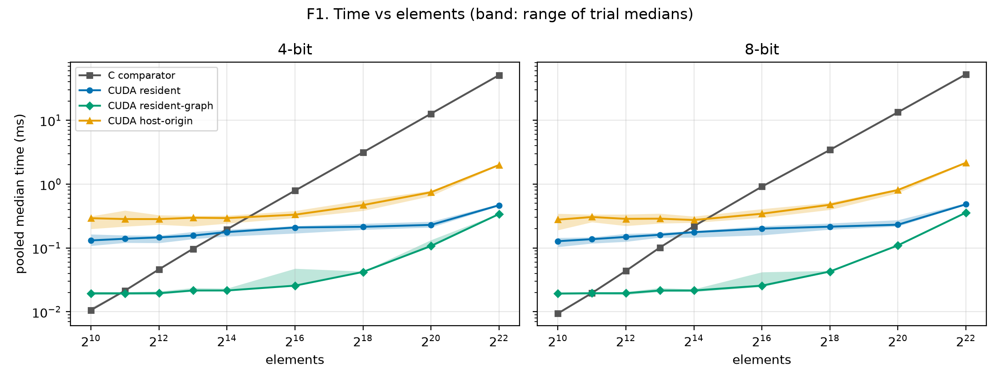
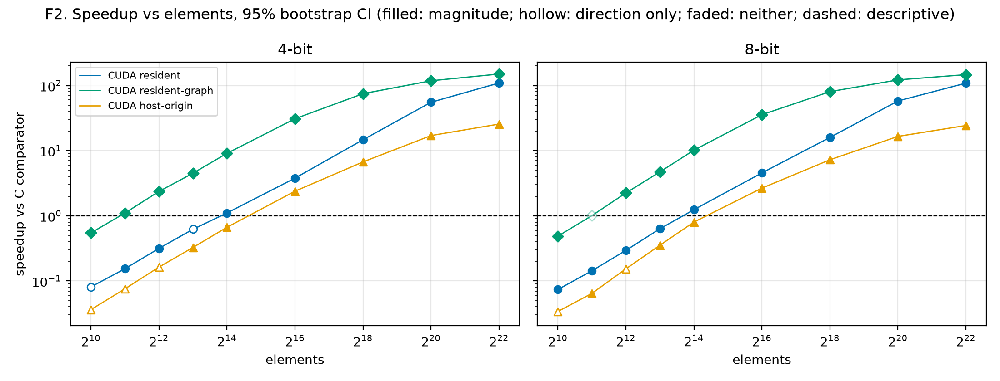
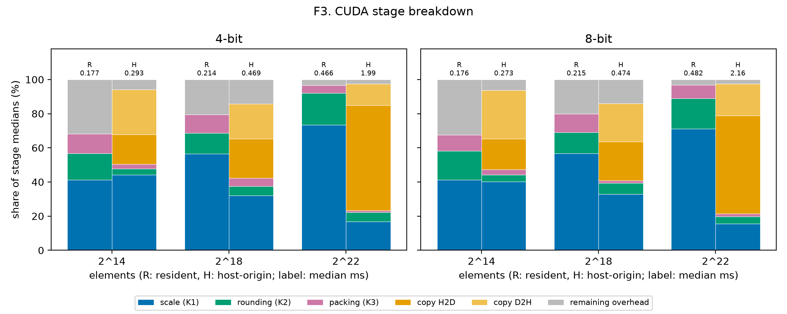
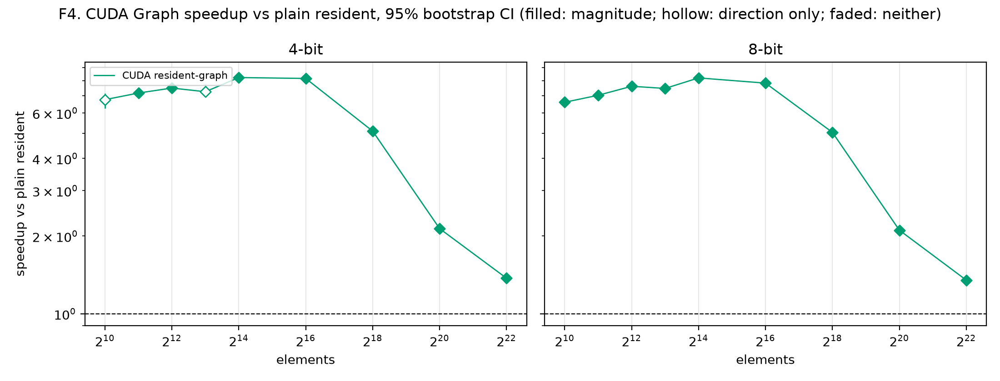

# Size sweep report (2026-11-26-5c4e64f-chan-run2)

Generated by `bench_report.py` from snapshot revision `5c4e64f`, 72 cases, all passed: True.

## Crossover

Located from the direction claim on both sides of the flip.

- CUDA resident, 4-bit: resolved between 2^13 and 2^14 elements (slower to faster).
- CUDA resident-graph, 4-bit: resolved between 2^10 and 2^11 elements (slower to faster).
- CUDA host-origin, 4-bit: resolved between 2^14 and 2^16 elements (slower to faster).
- CUDA resident, 8-bit: resolved between 2^13 and 2^14 elements (slower to faster).
- CUDA resident-graph, 8-bit: not resolved (largest supported slower size: 2^10; smallest supported faster size: 2^12).
- CUDA host-origin, 8-bit: resolved between 2^14 and 2^16 elements (slower to faster).

### Revision 2 crossover

Located from the unchanged revision 2 claim, for comparison.

- CUDA resident, 4-bit: not resolved (largest supported slower size: none; smallest supported faster size: 2^18).
- CUDA resident-graph, 4-bit: resolved between 2^10 and 2^11 elements (slower to faster).
- CUDA host-origin, 4-bit: not resolved (largest supported slower size: none; smallest supported faster size: 2^20).
- CUDA resident, 8-bit: not resolved (largest supported slower size: 2^13; smallest supported faster size: 2^22).
- CUDA resident-graph, 8-bit: not resolved (largest supported slower size: 2^10; smallest supported faster size: 2^12).
- CUDA host-origin, 8-bit: not resolved (largest supported slower size: none; smallest supported faster size: 2^20).

## T1. Summary

Times are pooled medians. Speedup is C median over CUDA median. The trial range decides the verdict; the 95% CI is the bootstrap interval over trial medians, so a speedup can lie outside its CI. Direction, magnitude and revision 2 are the claim rules recorded in the manifest; — marks a field the snapshot predates.

| Elements | Bits | Path | C (ms) | CUDA (ms) | Speedup | Trial range | 95% CI | Verdict | Direction | Magnitude | Rev 2 |
|---|---|---|---|---|---|---|---|---|---|---|---|
| 2^10 | 4 | CUDA resident | 0.0106 | 0.131 | 0.0809× | [0.0642, 0.107] | [0.077, 0.0876] | slower | yes | no | no |
| 2^10 | 4 | CUDA resident-graph | 0.0106 | 0.0194 | 0.546× | [0.511, 0.63] | [0.545, 0.559] | slower | yes | yes | yes |
| 2^10 | 4 | CUDA host-origin | 0.0106 | 0.2919 | 0.0363× | [0.0334, 0.0584] | [0.035, 0.0372] | slower | yes | no | no |
| 2^10 | 8 | CUDA resident | 0.0094 | 0.1274 | 0.0738× | [0.0645, 0.0907] | [0.0706, 0.0753] | slower | yes | yes | no |
| 2^10 | 8 | CUDA resident-graph | 0.0094 | 0.0193 | 0.487× | [0.477, 0.511] | [0.479, 0.491] | slower | yes | yes | yes |
| 2^10 | 8 | CUDA host-origin | 0.0094 | 0.2769 | 0.0339× | [0.027, 0.0494] | [0.0314, 0.0369] | slower | yes | no | no |
| 2^11 | 4 | CUDA resident | 0.0214 | 0.1391 | 0.154× | [0.134, 0.178] | [0.151, 0.157] | slower | yes | yes | no |
| 2^11 | 4 | CUDA resident-graph | 0.0214 | 0.0194 | 1.1× | [1.04, 1.16] | [1.1, 1.13] | faster | yes | yes | yes |
| 2^11 | 4 | CUDA host-origin | 0.0214 | 0.2831 | 0.0756× | [0.0549, 0.0992] | [0.0709, 0.084] | slower | yes | no | no |
| 2^11 | 8 | CUDA resident | 0.0196 | 0.137 | 0.143× | [0.132, 0.167] | [0.138, 0.145] | slower | yes | yes | yes |
| 2^11 | 8 | CUDA resident-graph | 0.0196 | 0.0195 | 1.01× | [0.992, 1.05] | [1, 1.01] | inconclusive | no | no | no |
| 2^11 | 8 | CUDA host-origin | 0.0196 | 0.3048 | 0.0643× | [0.0583, 0.0776] | [0.0618, 0.0682] | slower | yes | yes | no |
| 2^12 | 4 | CUDA resident | 0.0461 | 0.1461 | 0.316× | [0.292, 0.39] | [0.306, 0.324] | slower | yes | yes | no |
| 2^12 | 4 | CUDA resident-graph | 0.0461 | 0.0195 | 2.36× | [2.18, 2.5] | [2.36, 2.38] | faster | yes | yes | yes |
| 2^12 | 4 | CUDA host-origin | 0.0461 | 0.2828 | 0.163× | [0.14, 0.201] | [0.147, 0.175] | slower | yes | no | no |
| 2^12 | 8 | CUDA resident | 0.0437 | 0.1484 | 0.294× | [0.261, 0.352] | [0.288, 0.303] | slower | yes | yes | no |
| 2^12 | 8 | CUDA resident-graph | 0.0437 | 0.0195 | 2.24× | [2.12, 2.39] | [2.23, 2.25] | faster | yes | yes | yes |
| 2^12 | 8 | CUDA host-origin | 0.0437 | 0.2851 | 0.153× | [0.129, 0.199] | [0.139, 0.163] | slower | yes | no | no |
| 2^13 | 4 | CUDA resident | 0.0968 | 0.1559 | 0.621× | [0.537, 0.706] | [0.586, 0.636] | slower | yes | no | no |
| 2^13 | 4 | CUDA resident-graph | 0.0968 | 0.0215 | 4.5× | [4.06, 4.64] | [4.5, 4.54] | faster | yes | yes | yes |
| 2^13 | 4 | CUDA host-origin | 0.0968 | 0.2967 | 0.326× | [0.301, 0.446] | [0.316, 0.334] | slower | yes | yes | no |
| 2^13 | 8 | CUDA resident | 0.1014 | 0.1605 | 0.632× | [0.579, 0.7] | [0.615, 0.652] | slower | yes | yes | yes |
| 2^13 | 8 | CUDA resident-graph | 0.1014 | 0.0215 | 4.72× | [4.26, 4.98] | [4.7, 4.74] | faster | yes | yes | yes |
| 2^13 | 8 | CUDA host-origin | 0.1014 | 0.2873 | 0.353× | [0.291, 0.421] | [0.335, 0.363] | slower | yes | yes | no |
| 2^14 | 4 | CUDA resident | 0.1955 | 0.1769 | 1.1× | [1, 1.3] | [1.07, 1.12] | faster | yes | yes | no |
| 2^14 | 4 | CUDA resident-graph | 0.1955 | 0.0215 | 9.09× | [8.4, 9.23] | [9.08, 9.1] | faster | yes | yes | yes |
| 2^14 | 4 | CUDA host-origin | 0.1955 | 0.2933 | 0.667× | [0.606, 0.817] | [0.641, 0.699] | slower | yes | yes | no |
| 2^14 | 8 | CUDA resident | 0.2188 | 0.1764 | 1.24× | [1.17, 1.5] | [1.2, 1.25] | faster | yes | yes | no |
| 2^14 | 8 | CUDA resident-graph | 0.2188 | 0.0215 | 10.2× | [9.65, 10.7] | [10.2, 10.2] | faster | yes | yes | yes |
| 2^14 | 8 | CUDA host-origin | 0.2188 | 0.2732 | 0.801× | [0.699, 0.883] | [0.761, 0.836] | slower | yes | yes | no |
| 2^16 | 4 | CUDA resident | 0.7904 | 0.2089 | 3.78× | [3.55, 4.71] | [3.69, 3.95] | faster | yes | yes | no |
| 2^16 | 4 | CUDA resident-graph | 0.7904 | 0.0256 | 30.9× | [16.6, 31.1] | [30.7, 30.9] | faster | yes | yes | no |
| 2^16 | 4 | CUDA host-origin | 0.7904 | 0.3315 | 2.38× | [2.06, 2.7] | [2.34, 2.43] | faster | yes | yes | no |
| 2^16 | 8 | CUDA resident | 0.9129 | 0.2005 | 4.55× | [4.12, 5.78] | [4.31, 4.72] | faster | yes | yes | no |
| 2^16 | 8 | CUDA resident-graph | 0.9129 | 0.0256 | 35.7× | [21.7, 37.2] | [35.5, 35.7] | faster | yes | yes | no |
| 2^16 | 8 | CUDA host-origin | 0.9129 | 0.3433 | 2.66× | [2.22, 3.08] | [2.57, 2.75] | faster | yes | yes | no |
| 2^18 | 4 | CUDA resident | 3.148 | 0.2142 | 14.7× | [13, 16.5] | [14.1, 15] | faster | yes | yes | yes |
| 2^18 | 4 | CUDA resident-graph | 3.148 | 0.042 | 74.9× | [73.1, 76.1] | [74.7, 75.1] | faster | yes | yes | yes |
| 2^18 | 4 | CUDA host-origin | 3.148 | 0.4689 | 6.71× | [5.59, 8.36] | [6.58, 6.74] | faster | yes | yes | no |
| 2^18 | 8 | CUDA resident | 3.433 | 0.2152 | 16× | [14, 17.9] | [15.4, 16.6] | faster | yes | yes | no |
| 2^18 | 8 | CUDA resident-graph | 3.433 | 0.04265 | 80.5× | [77.4, 82.9] | [79.5, 81.8] | faster | yes | yes | yes |
| 2^18 | 8 | CUDA host-origin | 3.433 | 0.474 | 7.24× | [6.61, 8.79] | [7.05, 7.41] | faster | yes | yes | no |
| 2^20 | 4 | CUDA resident | 12.69 | 0.2293 | 55.3× | [48.5, 61.3] | [53.3, 56.3] | faster | yes | yes | yes |
| 2^20 | 4 | CUDA resident-graph | 12.69 | 0.1073 | 118× | [94.3, 124] | [118, 121] | faster | yes | yes | no |
| 2^20 | 4 | CUDA host-origin | 12.69 | 0.7448 | 17× | [15.9, 19.8] | [16.4, 18.3] | faster | yes | yes | yes |
| 2^20 | 8 | CUDA resident | 13.37 | 0.2309 | 57.9× | [48.5, 63] | [56.1, 58.5] | faster | yes | yes | no |
| 2^20 | 8 | CUDA resident-graph | 13.37 | 0.1096 | 122× | [116, 127] | [120, 123] | faster | yes | yes | yes |
| 2^20 | 8 | CUDA host-origin | 13.37 | 0.8081 | 16.6× | [15.6, 18.9] | [16.3, 17.3] | faster | yes | yes | yes |
| 2^22 | 4 | CUDA resident | 50.96 | 0.4658 | 109× | [104, 113] | [108, 110] | faster | yes | yes | yes |
| 2^22 | 4 | CUDA resident-graph | 50.96 | 0.3393 | 150× | [147, 152] | [150, 150] | faster | yes | yes | yes |
| 2^22 | 4 | CUDA host-origin | 50.96 | 1.991 | 25.6× | [25, 26.2] | [25.5, 25.7] | faster | yes | yes | yes |
| 2^22 | 8 | CUDA resident | 52.5 | 0.4823 | 109× | [103, 112] | [107, 110] | faster | yes | yes | yes |
| 2^22 | 8 | CUDA resident-graph | 52.5 | 0.3574 | 147× | [144, 150] | [146, 147] | faster | yes | yes | yes |
| 2^22 | 8 | CUDA host-origin | 52.5 | 2.159 | 24.3× | [23.9, 25] | [24.2, 24.5] | faster | yes | yes | yes |

## Figures

- 
- 
- 
- 
